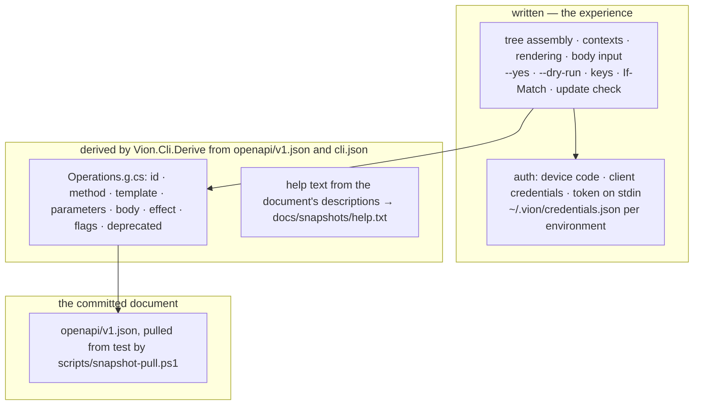

# `vion` v0.1.0 — the document rendered as a command line

> Change doc — one in-flight change. The `Spec delta` below is distilled into the current-truth
> pages under `docs/specs/` in the implementation PR, then this doc is archived
> (`spec-change.ps1 archive <slug>`). Process: `docs/spec-process.md`. Never put change narrative
> inline in a spec page — it lives here.

## At a glance

### Summary

`vion` v0.1.0: one NativeAOT binary for linux-x64, linux-arm64 and win-x64, installed from GitHub
Releases or `winget install vion`, whose command tree, options and help are derived from a committed
snapshot of cloud-api's OpenAPI document, and whose sign-in, contexts, rendering and write-safety
flags are written. Slice 4 of the cross-repo spec `specs/in-flight/2026-10-28-generation-and-vion.md`
(architecture); the brief `brief-generation-and-vion-4-vion-cli.md` fixes the contract, this doc fixes
the design, and nothing is built until Jonas ratifies it (STOP 1).

### Spec implications

This repository has no corpus yet. This change opts it into vion-sdd and creates its first page,
`docs/specs/cli.md` (area `CLI`, anchored by `docs/snapshots/help.txt`), with the criteria in § Spec
delta. The page cites `dale-sdk/AC-CLI-001.8` (UTF-8 output) and `dale-sdk/AC-CLI-001.10` (the
shape of a JSON document the tool writes itself) and states its own rules for everything else,
because `vion`'s stream rule and exit codes differ from `dale`'s (§ 7). No other page exists;
`_invariants.md` waits for the first cross-cutting rule.

### Decisions

Ratified upstream and cited, not relitigated: the names (`vion`, `VION-IoT.vion`, `Vion.Cli`,
`image: vion`), the generated–derived–written split, facts in the document and presentation in
`cli.json`, device code for humans and credentials or a token for automation, release archives and
winget with no image, no shared auth package with `dale`, the smoke suite as a cloud-api change doc,
and the non-goals (MCP, `watch`, pickers, aliases, macOS, signing, scoop, Homebrew) — brief
§ Constraints already decided 1–8.

Taken here (b, decide-and-document) — each with its rationale in § Full design:

- `D1` — **No Kiota: the derived operations table is the transport.** Every request is built from
  the table (method, path template, parameters, body content type) and sent through one
  `HttpClient`; payloads travel as `JsonNode`. Kiota's 71 000 generated lines would be committed,
  public and called by nothing, because a table-driven CLI never calls a typed builder (§ 2, § 4).
  This touches the ratified decision's wording "transport generated", so it is also question 1.
- `D2` — **The derive step is a solution project, `Vion.Cli.Derive`, run by `scripts/derive.ps1`,
  not an MSBuild target.** The derived file is committed source like the snapshot; the build never
  regenerates it; `derive.ps1 -Verify` is the gate in CI and the pre-PR obligation (§ 2). A project,
  not a file-based app, so its rules are unit-tested and cite criteria.
- `D3` — **One emitted file, `Vion.Cli/Derived/Operations.g.cs`**, a static table of `Operation`
  records, plus the snapshot's SHA-256 in its header, so a hand-edited snapshot or table is a diff.
- `D4` — **Root and project parameters are filled from the context and are not derived options.**
  `tenantId`, `integratorId`, `platformId` and `projectId` (path or query) take their values from
  `--tenant`, `--integrator`, `--platform`, `--project`, the `VION_*` variables, then the current
  context; so `--tenant` never sits beside a derived `--tenant-id`. `platform` is a fourth context
  key, because 45 of the 47 platform routes carry `{platformId}` (§ 3).
- `D5` — **`dryRun` binds to the global `--dry-run`**; it is the only live collision between a
  parameter and a global flag. Any other collision takes the suffix `-param` and the help snapshot
  shows it; the rule is proven on a synthetic document (§ 3).
- `D6` — **`If-Match` resolves in four steps**: `--if-match`; else `meta.version` of the `--input`
  document (the `get --json` → edit → `update --input` loop carries it for free, and `meta` is
  stripped from the sent body); else the aggregate's `get` on the same path where one exists (4 of
  31); else the command refuses before sending, exit 2, naming `--if-match` and the list row's
  `meta.version` (§ 4).
- `D7` — **The idempotency key is minted per write when absent; a replay is a notice on standard
  error** in both modes, so `--json`'s standard output stays the response body verbatim (§ 4, § 7).
- `D8` — **JSON mode is one document on standard output; notices go to standard error.** That is
  why `dale-sdk/AC-CLI-001.5` is not cited but restated as `vion`'s own criterion (§ 7).
- `D9` — **`ops` reads the snapshot, offline: the 264 tree rows, `--all` adding `system`'s 4.
  `ops --live` reads the environment's live document, tokenless, and diffs all 268 by operationId**
  (§ 5). The spec's "264" and "live catalog" are both honoured by giving each its flag.
- `D10` — **`secrets: inherit` is dropped from `ci-cd.yml`.** With `push-image: false` the workflow
  reads no secret (`dotnet-aot-app.yml:117`), and inheriting would hand the architecture App key to
  a public workflow it does not need (§ 9).
- `D11` — **The SDK pin is `10.0.300`**, the one SDK on this machine (`dotnet --list-sdks`) and a
  published Alpine image tag (`docker manifest inspect mcr.microsoft.com/dotnet/sdk:10.0.300-alpine3.23`
  succeeded 2026-10-28). mesh is on 10.0.401; the bump is a chore once the SDK is installed here.
- `D12` — **Tests are MSTest with `[TestProperty("spec", "AC-CLI-…")]`**, dale-sdk's form; the
  seams are a fake `HttpMessageHandler`, a temporary store root, a `TimeProvider` and a
  console-is-a-terminal flag.
- `D13` — **Three pull requests** (§ 13): the repository and the offline tree; sign-in, contexts and
  the write-safety flags; the release. The change doc stays `in-flight` across the first two and
  archives in the second; the first distils its own criteria into `cli.md` so the marked page never
  declares zero ids.
- `D14` — **The throwaway resource for the write-safety checks is a dashboard named
  `vion-cli-smoke-2026-10-28`** in a test tenant Jonas names at sign-in, created and deleted by
  `vion` itself (`tenant.dashboard.create` / `.delete`); `tenant.dashboard.update` is one of the
  two 428 operations, so the stale-`If-Match` check hits the strict path.

Added at ratification (Jonas, 2026-10-28), ratified with the rest:

- `D15` — **`winget-releaser` is pinned by commit** (`b7370d4d152efdce803a26cc6ca9eee58cb2ad54`, the
  `v2` tag on 2026-10-28, `gh api repos/vedantmgoyal9/winget-releaser/git/ref/tags/v2`), as
  `spec-gates.yml` pins `create-github-app-token`: it is handed `WINGET_TOKEN`.
- `D16` — **`docs/testing-conventions.md` exists from PR 1**, dale-sdk's text adapted, carrying § 10's
  seams as its § 2; `CLAUDE.md`'s read-before-you-write table points at it.
- `D17` — **Branch protection on `main` joins STOP 2's settings**: one approving review and the
  required checks, set after PR 1's first CI run names them (§ 9 carries the call).

### Reviewer's questions

1. **(c) Transport without Kiota — D1.** The brief and spec say "Kiota 2.x bundle" and "transport
   generated". Options: **A** — no Kiota; the table is the transport, `JsonNode` the payload, one
   `HttpClient`; the layout loses `openapi/kiota-lock.json` and `Vion.Cli/Generated/`
   (recommended, § 2 and § 11). **B** — Kiota's runtime without its generated code: build
   `RequestInformation` from the table and send through `HttpClientRequestAdapter`; gains a
   URI-template library and a retry handler, costs five packages and a second serializer. **C** —
   Kiota as specified, generated client committed, the table mapped onto request builders by
   re-implementing Kiota's naming (or reading `kiota-lock.json`); 71k public lines, called through
   reflection-free dispatch that must be regenerated per snapshot. A's reading of the decision: the
   transport is still generated from the document — by the derive step rather than by Kiota — and
   nothing per operation is written.
   OUTCOME: accepted, A (Jonas, 2026-10-28, STOP 1).
2. **(c) The derive step as a project and a script — D2, D3.** The brief lists `derive/` as a
   file-based app under an incremental MSBuild target. Options: **A** — `Vion.Cli.Derive/` in the
   solution, `scripts/derive.ps1 [-Verify]` the one entry, the derived file and help snapshot
   committed (recommended). **B** — the brief's shape; the file-based app inherits
   `Directory.Build.props`' locked-restore properties and cannot be unit-tested, and the spike
   reported the target plumbing as its second-worst pain.
   OUTCOME: accepted, A (Jonas, 2026-10-28, STOP 1).
3. **(c) The context model — D4.** Four keys (`integrator`, `tenant`, `project`, `platform`); root
   parameters are never derived options; `context use` stores GUIDs only in v0.1.0 (no slug
   resolution through `/me`, no auto-select of a sole membership — `whoami` prints the ids to pick
   from). Alternative: `dale`'s auto-select when the caller has one membership of a kind; left out
   as magic the first users do not need, proposed for a later change.
   OUTCOME: accepted as proposed (Jonas, 2026-10-28, STOP 1).
4. **(c) What `ops` lists — D9.** `ops` 264 offline, `ops --all` 268, `ops --live` the diff over
   268 with exit 1 on any difference (so the smoke suite can use it). Alternative: `ops` reading the
   live catalog, which needs a token and makes the count per environment.
   OUTCOME: accepted as proposed (Jonas, 2026-10-28, STOP 1).
5. **(c) The pull-request sequence — D13**, three PRs; or one PR carrying everything, the method's
   default, at the cost of one review over the whole binary.
   OUTCOME: accepted, three pull requests (Jonas, 2026-10-28, STOP 1). The decide-and-document
   items D10, D11, D14 and D8 were confirmed in the same answer.

---

## Full design

Claims about the document are from the live test document pulled 2026-10-28
(`curl https://api.test.vion.swiss/openapi/v1.json`, 1 511 273 bytes, OpenAPI 3.1.1, 268
operations: tenant 116, integrator 92, platform 47, me 9, system 4), counted with a script over
the file; counts are re-derived at the snapshot's own commit, not carried from the brief.

### 1. Layers and layout



The transport is the derived table and one `HttpClient` (D1). The layout, with the two changes from
the brief's (no Kiota files; `Vion.Cli.Derive/` instead of `derive/`):

```
vion-cli/
  CLAUDE.md  README.md  LICENSE  CONTRIBUTING.md  SUPPORT.md  SECURITY.md
  global.json  Directory.Build.props  Vion.Cli.sln  Vion.Cli.sln.DotSettings
  .config/dotnet-tools.json  .editorconfig  .gitattributes  .gitignore  .claude/settings.json
  .claude/commands/cleanup.md
  .github/  CODEOWNERS  pull_request_template.md  release.yml  dependency-majors-allowed.json
            workflows/ci-cd.yml  workflows/gates.yml  workflows/close-external-prs.yml
            workflows/winget.yml
  openapi/v1.json                                   the committed snapshot
  cli.json                                          presentation lists, empty, checked by derive
  Vion.Cli.Derive/                                  the derive step: reads the snapshot and cli.json
  Vion.Cli/      Program.cs  Auth/  Context/  Rendering/  Commands/  Http/     written
  Vion.Cli/Derived/Operations.g.cs                  emitted by Vion.Cli.Derive, committed, diffed
  Vion.Cli.Test/                                    MSTest; tests Vion.Cli and Vion.Cli.Derive
  docs/  specs/_corpus.yml  specs/cli.md  spec-process.md  snapshots/help.txt
         changes/_template.md  changes/2026-10-28-vion-0-1-0.md
         review-checks.md  comment-conventions.md  releasing.md
         process-journal/README.md  process-journal/<date>-feat-generation-and-vion-4.md
  scripts/  snapshot-pull.ps1  derive.ps1  cleanup-code.ps1
```

**Precedent per file** (the brief: copy from dale-sdk file by file and name the precedent):

| file | precedent | what changes in the copy |
|---|---|---|
| `CLAUDE.md` | `dale-sdk/CLAUDE.md` for the header, the layout and § Parallel sessions; `architecture/templates/working-agreement.md` for the block and the six-row table, byte for byte, the template winning where dale-sdk's copy lacks `### Design` | the two `vion-sdd` rows; the four `pass` roles; obligations with `On …:` triggers: `*.cs`, `*.csproj`, the `.sln`, `Directory.Build.props`, `.config/dotnet-tools.json` → `/cleanup`, `dotnet build Vion.Cli.sln`, `dotnet test Vion.Cli.sln`; `openapi/**`, `cli.json`, `Vion.Cli.Derive/**`, `Vion.Cli/**` → `pwsh scripts/derive.ps1 -Verify`; `docs/specs/**`, `docs/changes/**`, `*.Test/**` → `spec-lint`, `spec-trace`; the read-before-you-write table pointing at `docs/specs/cli.md`, `docs/comment-conventions.md`, `docs/releasing.md`, `docs/review-checks.md`; under 10 kB |
| `.claude/settings.json` | `dale-sdk/.claude/settings.json` | none: attribution only (`concepts/development-process.md` § What a repo owns) |
| `.claude/commands/cleanup.md` | `dale-sdk/.claude/commands/cleanup.md` | the solution and DotSettings names |
| `LICENSE`, `CONTRIBUTING.md`, `SUPPORT.md`, `SECURITY.md`, `.github/CODEOWNERS`, `.github/workflows/close-external-prs.yml`, `.github/release.yml` | dale-sdk's, each | `SECURITY.md` names the binary and the archives instead of the packages; the rest verbatim |
| `.github/pull_request_template.md` | dale-sdk's | `## Gates` names this repo's obligations (build, test, cleanup `-Verify`, `derive.ps1 -Verify`, `spec-lint`, `spec-trace`) instead of `scripts/check.ps1` |
| `README.md` | dale-sdk's shape (quick start, source-available, maintainers) | the install page: the archives per target with `sha256sum -c`, `winget install vion`, the three credential paths, `vion context use`, three commands to try |
| `docs/review-checks.md` | dale-sdk's grammar; `vion-git`'s template owns it | this repo's own checks, starting with six: the derived table is never edited by hand; a count in a doc is pasted with its command; the help snapshot diff is read as the review of an API move; a secret, customer name or cluster-internal host never enters the public tree; a claim about the document carries the operationId; a notice never lands on JSON mode's standard output |
| `docs/process-journal/README.md` | dale-sdk's | verbatim: `retro at: 40` |
| `docs/changes/_template.md`, `docs/specs/_corpus.yml`, `docs/spec-process.md` | `architecture/plugins/vion-sdd/templates/` | `_corpus.yml`: `owns: [CLI]`, `tests: ["**/*.Test/**/*.cs"]`, `cites: [dale-sdk]` (done); `spec-process.md` filled as dale-sdk's and cloud-api's: § The roster (`cli.md` · `CLI` · the help snapshot; `MCP` and `WATCH` reserved), § Routing, § Gates (the three plus `derive.ps1 -Verify`, `cleanup-code.ps1 -Verify`, `journal-lint`), no § What a pass adds until a pass runs |
| `docs/comment-conventions.md` | dale-sdk's C# text | verbatim but the XML-docs pointer, which goes (no published types) |
| `docs/releasing.md` | dale-sdk's § Cutting a release and § When the release smoke fails, mesh's tag scheme | `gh release create vX.Y.Z --target main --generate-notes`; what `ci-cd.yml` attaches; the winget step; the re-cut procedure |
| `global.json` | `mesh/global.json` | `10.0.300`, `rollForward: disable` (D11) |
| `Directory.Build.props` | `mesh/Directory.Build.props` (decisions 0221, 0223) | `net10.0`, locked restores, `IsAotCompatible`, `InvariantGlobalization`, `TreatWarningsAsErrors`, `AnalysisMode All` with mesh's `NoWarn` list, the `0.0.0-local` version fallback, `IsTestInfrastructure` by the `.Test` suffix; `IsPublishable` true only for `Vion.Cli` |
| `Vion.Cli/Vion.Cli.csproj` | `mesh/Mesh/Mesh.csproj` | `AssemblyName` `vion`, `PublishAot`, `StaticExecutable` `true` (proven on glibc, § 12), `InvariantGlobalization`, `JsonSerializerIsReflectionEnabledByDefault` `false`, `StripSymbols` with symbols kept out of the publish directory as mesh's `RemoveSymbolsFromPublish` does, `RuntimeIdentifiers` `linux-musl-x64;linux-musl-arm64;win-x64` |
| `.config/dotnet-tools.json`, `scripts/cleanup-code.ps1`, `Vion.Cli.sln.DotSettings` | mesh's tool version, dale-sdk's script and profile | the solution name; the `wwwroot` exclusion goes |
| `.editorconfig`, `.gitattributes`, `.gitignore` | dale-sdk's | verbatim; `.gitignore` loses the DevHost lines |
| `.github/workflows/gates.yml` | `dale-sdk/.github/workflows/spec-gates.yml` | three jobs: `journal-lint` (the shared action), `vion-sdd` (the token step at `:119-124` and the tarball route, verbatim with `repositories: architecture`), and `derive` (`actions/setup-dotnet` from `global.json`, `pwsh scripts/derive.ps1 -Verify`); on `push` to `main` and `pull_request` with `fetch-depth: 0` |
| `.github/workflows/ci-cd.yml` | `mesh/.github/workflows/mesh.yml` | as the brief decided, without `secrets: inherit` (D10) and without `docker-context` |
| `.github/workflows/winget.yml` | none in the org; the `winget-releaser` action's documented shape | § 9 |
| `.github/dependency-majors-allowed.json` | mesh's | `[]` |
| `scripts/snapshot-pull.ps1`, `scripts/derive.ps1` | dashboard's `scripts/capabilities-pull.ts` (regenerate-and-diff) as the pattern; dale-sdk's `publish.yml:285-308` for walking the tree for the help snapshot | new |
| `Vion.Cli/Auth/` | `dale-sdk/Vion.Dale.Cli/Auth/TokenStore.cs` (the store root seam `UseRoot`, the 0600 mode, the four hosts), `TokenProvider.cs` (the precedence chain), `AuthService.cs` (the token-endpoint exchanges) | the device flow replaces the loopback PKCE; the store is keyed by environment; a Windows ACL is added |
| `Vion.Cli.Test/` | `dale-sdk/Vion.Dale.Cli.Test/` (`TokenStoreShould`, `TemporaryStoreRoot`) | the seams in § 10 |

### 2. The snapshot and the derive step

**`scripts/snapshot-pull.ps1`** pulls `https://api.test.vion.swiss/openapi/v1.json` (no token) into
`openapi/v1.json`, pretty-printed with two-space indentation and sorted keys so a diff reads per
operation, and prints the operation count and the SHA-256 of the written file. `-ApiUrl` takes
another environment's base, for a one-off diff; the committed snapshot is test's by the spec.

**`Vion.Cli.Derive`** is a console project in the solution (D2): `dotnet run --project
Vion.Cli.Derive -- <snapshot> <cli.json> <out dir>`. It reads the document with
`System.Text.Json`'s `JsonDocument`, never a generator, so the `x-vion-*` extensions reach it. Per
operation it emits one record:

```csharp
// Vion.Cli/Derived/Operations.g.cs — generated by Vion.Cli.Derive from openapi/v1.json
// (sha256 <hex>) and cli.json. Do not edit; run scripts/derive.ps1.
public static partial class Operations
{
    public static readonly ImmutableArray<Operation> All =
    [
        new("tenant.edgeGateway.list", Domain: "tenant", Aggregate: "edgeGateway", Verb: "list",
            Method: "GET", Template: "/tenant/{tenantId}/edgeGateways",
            Description: "Returns all edge gateways for a tenant",
            Parameters: [
                new("tenantId", In.Path, Required: true, Kind: ParameterKind.Uuid, Description: "The tenant whose edge gateways are listed."),
                new("projectId", In.Query, Required: false, Kind: ParameterKind.Uuid, Description: "Lists only the rows in this project …"),
                new("edgeGatewayId", In.Query, Required: false, Kind: ParameterKind.Uuid, Description: "…")],
            Body: null,
            Effect: Effect.Read, Idempotent: false, Versioned: false, DryRun: false, Deprecated: false,
            Authorization: new("Filtered", ["Project.Read"], ScopeType: "EdgeGateway", ScopeFrom: "id"),
            Hidden: false, Alias: null),
        …
    ];
}
```

`Operation`, `Parameter`, `Body` (`ContentType`, `SchemaName`, and for multipart the file part's
name and the text parts' names) and `Authorization` are records in `Vion.Cli/Derived/Operation.cs`,
hand-written, so the emitter writes only data. `ParameterKind` is `String`, `Uuid`, `Boolean`,
`Integer`, `DateTime`, `StringArray` — from `schema.type` and `format`, enough to type the option
and to validate before sending; everything travels as a string on the wire. The derived name of
each option and the command's three kebab-case segments are also emitted, so the naming rule is
applied in one place (the derive step) and the binary only reads it.

**`cli.json`** is `{ "<operationId>": { "hide": bool, "alias": "<name>", "picker": … } }`, empty
in this change (`{}`); the derive step fails on a key the snapshot lacks, naming it (`AC-CLI-001.5`),
and emits `Hidden` and `Alias` onto the record. `picker` is parsed and ignored until the spec that
defines pickers.

**`scripts/derive.ps1`** is the one entry point:

1. `dotnet run --project Vion.Cli.Derive -- openapi/v1.json cli.json Vion.Cli/Derived` — regenerates
   `Operations.g.cs`.
2. `dotnet build Vion.Cli -c Debug`, then runs the built `vion` with the hidden command
   `vion __help-snapshot`, which walks its own command tree depth-first and prints each command's
   help under a `## vion <path>` heading separated by `---`, dale's snapshot shape
   (`publish.yml:285-308`) done inside the tool rather than by a shell loop, so that every option
   surface is inside the gate by construction. The output is `docs/snapshots/help.txt`.
3. With `-Verify`: refuses on a dirty tree for those paths (as `cleanup-code.ps1 -Verify` refuses),
   then fails with the `git diff --stat` when step 1 or 2 changed `Vion.Cli/Derived/**` or
   `docs/snapshots/help.txt`.

Why no MSBuild target: the derived file is committed, so a build never needs to regenerate it; what
must hold is that the committed file matches the committed snapshot and `cli.json`, and `-Verify` in
CI and the pre-PR obligation hold exactly that. Incrementality is then a non-question. The help
snapshot needs a built binary either way, which a target inside that binary's own build cannot
provide; the script sequences it.

**The gate's reach**: `derive.ps1 -Verify` fails on a hand-edited snapshot (the SHA in the header
differs), a hand-edited table, a stale table after `snapshot-pull.ps1`, a `cli.json` entry the
snapshot lacks, and any help text drift. The brief's check "`derive.ps1 -Verify` red on a
hand-edited snapshot" is run and pasted under Verification.

### 3. The tree

`vion <domain> <aggregate> <verb>` for every operation whose domain is `tenant`, `integrator`,
`platform` or `me`: `tenant.edgeGateway.list` → `vion tenant edge-gateway list`,
`me.notificationPreferences.update` → `vion me notification-preferences update`,
`me.notification.markRead` → `vion me notification mark-read`. Kebab case is `(?<=[a-z0-9])([A-Z])`
→ `-$1`, lower-cased. 264 commands at the snapshot; `system`'s 4 stay out (`AC-CLI-001.1`); a
`deprecated` operation is built but hidden from help (`AC-CLI-001.2`, none today). All 268 are
reachable through `api`.

**Options.** Each path or query parameter becomes `--<kebab name>` typed by `ParameterKind`
(`--unread` a flag, `--limit <int>`, `--scope-id <uuid>` repeatable for an array parameter, sent as
repeated keys, the `form`/`explode` default ASP.NET binds). Four names are **context parameters**
and are not derived (D4): `tenantId`, `integratorId`, `platformId`, `projectId`, wherever they
appear (path or query). They are filled from the global `--tenant`, `--integrator`, `--platform`,
`--project`, then the current context. A required one with no value refuses before sending, exit 2,
naming the option and `context use` (`AC-CLI-002.2`); an optional one (`projectId` as a list filter)
is simply omitted. `dryRun` binds to the global `--dry-run` (D5). The one remaining collision rule:
a derived name equal to any global option's name takes the suffix `-param` (`AC-CLI-001.4`); no
parameter in the snapshot hits it (counted: the only overlaps are `id`, which is not global, and
`dryRun`), so the rule is proven on a synthetic document in `Vion.Cli.Test`.

Globals, on every command: `--env`, `--integrator`, `--tenant`, `--project`, `--platform`,
`--json`, `--fields`, `--yes`, `--dry-run`, `--idempotency-key`, `--if-match`, `--input`, `-f`,
`-F`, `--file`, `--token`, `--client-id`, `--client-secret`, `--verbose`, `--help`, `--version`.
`--input`, `-f`, `-F` and `--file` are shown only on commands with a body; the rest everywhere.

**Bodies.** A JSON body comes from `--input <file|->` or from `-f key=value` (string) and
`-F key=value` (typed: `true`, `false`, `null`, a number, `@file` for the file's content, else a
string), `gh api`'s shape; dotted keys nest (`-F layout.columns=3`). The two multipart operations
take `--file <path>` as the schema's file part (`nugetPackageFile`, `file`) and `-f` pairs as text
parts (`releaseNotes`, `tags` repeated) (`AC-CLI-002.7`).

**Help.** Each derived command's description is the operation's `description`; each option's, the
parameter's; the body options' help names the body schema. The root help lists the four domains and
the written commands; a domain's help lists its aggregates; an aggregate's, its verbs. Platform
commands show for everyone (the brief: hiding by permission would make the snapshot differ per
user).

### 4. The wire

One `HttpClient` with the environment's `apiUrl` as base, `Authorization: Bearer <token>` from § 6,
`Accept: application/json`, a `User-Agent` of `vion/<version>`. A request is built from the
operation's template with each path parameter substituted (URL-escaped) and each given query option
appended (`AC-CLI-002.1`). The body is the `JsonNode` from `--input` or the pairs, serialized with
`JsonNode.ToJsonString()` — no reflection, no `JsonSerializerContext` needed for pass-through; a
multipart body uses `MultipartFormDataContent`.

| flag | when | what is sent and reported |
|---|---|---|
| `--idempotency-key <key>` | the operation is `idempotent` (every non-Read with a principal, 155 today) | the header, the given key or a fresh GUID; `Idempotency-Replayed: true` on the answer → a notice on standard error, `replayed: the first answer under this idempotency key` (`AC-CLI-002.3`, D7) |
| `--if-match <version>` | the operation is `versioned` (31) | D6's four steps (`AC-CLI-002.4`); a 412's `currentVersion` is rendered with the error |
| `--yes` | the effect is `Irreversible` (82) | on a terminal, a prompt naming the command and its `--id`; without a terminal and without `--yes`, refusal with exit 2 before any request (`AC-CLI-002.5`) |
| `--dry-run` | the operation is `dryRun` (3) | `?dryRun=true`; on any other operation refusal with exit 2 (`AC-CLI-002.6`) |

A 404 with no `ApiExceptionDto` body is the host's own "no such route": `vion` says the operation is
not in that environment's document and points at `ops --live` (`AC-CLI-002.8`). A 404 with a body
is a resource the caller may not see, rendered as any error.

### 5. The written commands

- `auth login [--no-browser] [--env <name>]`: device code against the environment's realm (§ 6).
- `auth logout [--env <name>]`: removes that environment's credentials, says whether any were there.
- `auth status [--json]`: per stored environment the subject (`preferred_username` or `sub` from the
  JWT payload, decoded without validation), the expiry, whether a refresh token is held; and which
  source the next call would use given the process's flags and variables (`AC-CLI-004.7`).
- `context use [<name>] [--env <name> [--api-url <url> --auth-url <realm url>]] [--integrator <id>]
  [--tenant <id>] [--project <id>] [--platform <id>]`: with only a name, selects it; otherwise
  creates or updates the context named `<name>`, default the environment's name, with the values
  given, and selects it. A custom environment is defined by `--api-url` and `--auth-url` on the same
  command and stored under `environments` in `config.json`.
- `context list`, `context show`: the stored contexts with the current marked; the current one with
  its resolved environment URLs and roots.
- `whoami`: `me.identity.get`, rendered as the identity and three membership tables with ids.
- `can-i <operationId> [--project <id>]`: `system.capability.list` (the environment's catalog, with
  the token) joined with the context root's `*.myPermissions.get`, decided as the dashboard's
  `can.ts` `decide` does: an operation of another domain than the context's, an unknown mode, an
  empty permission list, a `Filtered` or `Scope` operation without a project target, answer
  *allowed*; `Root` answers from `root`; `Filtered` and `Scope` at `--project` from the held scope
  whose `projectId` is that project, else `root`; an operation the catalog lacks answers *unknown*.
  Prints the decision and the required permissions; exit 0 allowed, 1 denied, 2 unknown.
- `ops [--all] [--json]`: from the snapshot, offline (D9). `ops --live [--json]`: pulls the
  environment's live document (tokenless) and prints added, removed and changed operations
  (`x-vion-authorization` or `x-vion-capability` differ, or method/path); exit 0 only when the sets
  are identical.
- `api <METHOD> <path> [-f k=v]… [-F k=v]… [--input <file|->]`: the raw call with the resolved
  token; pairs are the query on `GET` and the JSON body otherwise; rendered as any answer.
- `__help-snapshot` (hidden): § 2.

### 6. Sign-in, stores and environments

**Environments** are `{ name, apiUrl, authUrl, clientId }`, `clientId` defaulting to `vion-cli`.
Built in: `production` (`https://api.vion.swiss`, `https://auth.vion.swiss/realms/vion`) and
`test` (`https://api.test.vion.swiss`, `https://auth.test.vion.swiss/realms/vion`) — dale's hosts,
`TokenStore.cs:118-132`. Resolution order for the environment and each root: the command's flag,
the variable (`VION_ENV`; `VION_API_URL` and `VION_AUTH_URL` override the resolved environment's
URLs), the current context (`AC-CLI-005.3`).

**Device code** (`AC-CLI-004.1`, `.2`): `POST <authUrl>/protocol/openid-connect/auth/device` with
`client_id=vion-cli&scope=openid user_impersonation web_mqtt_access`; print
`verification_uri_complete` and `user_code`; open the browser unless `--no-browser` (`xdg-open`,
`open`, or `Process.Start` with `UseShellExecute` on Windows, failure falling back to the printed
URL); poll `POST …/token` with `grant_type=urn:ietf:params:oauth:grant-type:device_code` every
`interval` seconds, `+5` on `slow_down`, on `authorization_pending` keep going, until `expires_in`
elapses (`expired_token`, `access_denied` → exit 1). The token response is parsed with a
`JsonSerializerContext` (`TokenResponse`, `DeviceCodeResponse`, `StoredCredentials`,
`CliConfig`, `UpdateCheck`, `ApiError` — the only typed shapes the binary serializes).

**Credential precedence** (`AC-CLI-004.4`): `--token -` reads one line from standard input;
`--client-id`/`--client-secret`; `VION_CLIENT_ID`/`VION_CLIENT_SECRET` (client credentials against
`<authUrl>/protocol/openid-connect/token` with `scope=openid`, not cached; cloud-api's
service-account clients carry `api_access basic web_mqtt_access` and land in the client-credentials
scheme as service accounts — brief's correction, `KeycloakAdminService.cs:36`,
`ApiAuthenticationExtensions.cs:188` — so `vion` assumes nothing about the principal); then the
store, refreshing a token that expires within 30 s with its refresh token
(`grant_type=refresh_token`); a failed refresh says so and names `auth login`. No source → exit 1
naming `auth login`, `VION_CLIENT_ID`/`VION_CLIENT_SECRET` and `--token` (`AC-CLI-004.5`).

**Stores** under `~/.vion/` (the user profile; `VION_HOME` overrides, which is also the test seam
as dale's `UseRoot`):

```jsonc
// credentials.json — mode 0600 on Unix (File.SetUnixFileMode), on Windows an ACL with inheritance
// off and one full-control rule for the current user (System.IO.FileSystem.AccessControl, inbox)
{ "test":       { "accessToken": "…", "refreshToken": "…", "expiresAt": "2026-10-28T21:00:00Z", "obtainedBy": "device" },
  "production": { … } }
// config.json
{ "current": "test",
  "contexts":     { "test": { "env": "test", "tenant": "<guid>", "project": null, "integrator": null, "platform": null } },
  "environments": { "acme-hosting": { "apiUrl": "https://api.acme.example", "authUrl": "https://auth.acme.example/realms/vion", "clientId": "vion-cli" } } }
// update-check.json
{ "checkedAt": "2026-10-28T20:00:00Z", "latest": "0.1.0" }
```

Both files are written atomically (write a sibling, then move). The Windows ACL is `[assumed:
System.IO.FileSystem.AccessControl is AOT-clean — it is P/Invoke over advapi32; proven by the
win-x64 publish in CI and `icacls` on the file]`.

### 7. Rendering, errors, exit codes

Table mode: a list answer (`{ items }`, with `nextCursor` where paged) renders as a Spectre row
table, columns the `--fields` or, by default, every top-level scalar member except `meta`, in
document order; any other object renders as a key–value table, nested values as compact JSON
(`AC-CLI-003.3`). A paged list prints `next cursor: <value>` on standard error; `--cursor` is the
derived option that takes it back. `--fields a,b` projects rows and objects alike, in both modes,
with dotted paths (`meta.version`) allowed (`AC-CLI-003.2`).

JSON mode (`--json`): standard output carries exactly one JSON document — the response body
verbatim (re-indented), or `{ "error": { "status": 412, "message": "…", "problems": [...],
"currentVersion": "3", "requiredPermissions": [...], "exceptionId": "…" } }` — and nothing else
(`AC-CLI-003.1`, D8). Notices (replay, next cursor, update available) go to standard error in
both modes; a prompt is only ever on a terminal. Documents `vion` writes itself (`ops`, `context
list`, `auth status`) follow `dale-sdk/AC-CLI-001.10` (camelCase, strings for enums, indented);
output is UTF-8 whatever the console's encoding, `dale-sdk/AC-CLI-001.8`, verified by the same probe
dale uses. `dale-sdk/AC-CLI-001.5` is **not** cited: it suppresses every human-readable line in JSON
mode, and `vion` keeps notices on standard error so that `--json` output is still the API's body.

An API error (`AC-CLI-003.4`): table mode prints to standard error `error <status> <statusCode>:
<message>`, one line per `problems[]` entry (`  - <code>: <message>`), `required permissions: …` on
a 403, `current version: …` on a 412, `exception id: …` on a 500; a 401 with no body prints the
`WWW-Authenticate` challenge and names `auth login`. Exit codes (`AC-CLI-003.5`): 0 success, 1 a
failed call or sign-in, 2 usage — a parse error, a missing required option, a refused `--yes`,
`--dry-run` on the wrong operation, an unresolvable `If-Match`, an unknown `can-i` operation.

### 8. The update check

Once a day, on a terminal only (standard error is a TTY), `GET
https://api.github.com/repos/VION-IoT/vion-cli/releases/latest` with a 2 s timeout; the result is
cached in `update-check.json`; a newer `tag_name` than the running version prints one line on
standard error naming the version and the release URL (`AC-CLI-007.1`). `VION_NO_UPDATE_CHECK=1`
skips it; a failure is silent and re-tried the next day. Never in JSON mode.

### 9. Build, CI, release, winget

**`ci-cd.yml`** (precedent `mesh.yml`): `push` to `main` and `v*`, `pull_request` with
`[opened, synchronize, reopened, ready_for_review]`, `workflow_dispatch`; one `ci-cd` job with
`permissions: contents: write`, `uses: VION-IoT/shared-workflows/.github/workflows/dotnet-aot-app.yml@v1`,
`solution: Vion.Cli.sln`, `publish-project: Vion.Cli/Vion.Cli.csproj`, `image: vion`, `run-tests:
true`, `linux-x64: true`, `linux-arm64: true`, `win-x64: true`, `linux-release-archives: true`,
`push-image: false`, `publish-only-on-build-changes: true`, `keep-pr-artifacts: false`,
`check-dependency-majors: true`, `dependency-majors-allow-list:
.github/dependency-majors-allowed.json`; no `secrets:` line (D10). The workflow's style step runs
`scripts/cleanup-code.ps1 -Verify -NoBuild` (`actions/dotnet-gate/action.yml`), the script dale's.
The Linux archives hold the publish directory at the root; `vion.dbg` is kept out of the publish
by the csproj (mesh's `RemoveSymbolsFromPublish`), so an archive is the executable alone.

**`gates.yml`** (precedent `spec-gates.yml`): `journal-lint`, `vion-sdd` (tarball route, secrets
`ARCHITECTURE_APP_CLIENT_ID` and `ARCHITECTURE_APP_PRIVATE_KEY` — **red until Jonas adds them,
STOP 2**; a fork's PR gets none and `close-external-prs.yml` closes it), and `derive`
(`setup-dotnet` from `global.json`, `pwsh scripts/derive.ps1 -Verify`). All three `if:
github.actor != 'github-actions[bot]'`.

**Release** (`docs/releasing.md`): `gh release create vX.Y.Z --target main --generate-notes`; the
tag runs `ci-cd.yml`, which attaches `vion-X.Y.Z-linux-musl-x64.tar.gz`, `…-linux-musl-arm64.tar.gz`,
`vion-X.Y.Z-win-x64.zip`, each with `.sha256`. The release notes are sectioned by `release.yml`
(feat, fix, chore, Other). The Linux job does not wait for the zip, so a release can briefly hold
two archives and no zip (slice 3's note); the winget step waits.

**winget** (`winget.yml`): on `release: published`, a job that waits for the zip asset (polls `gh
release view --json assets` up to 20 minutes), then `vedantmgoyal9/winget-releaser@v2` with
`identifier: VION-IoT.vion`, `installers-regex: '-win-x64\.zip$'`, `token: ${{ secrets.WINGET_TOKEN }}`
— a classic PAT with `public_repo` on an account that owns a fork of `microsoft/winget-pkgs` (STOP
2, when PR 3 needs it). The action updates an existing manifest only, so the **first** submission at
v0.1.0 is `wingetcreate new` from the zip URL, as a portable installer (`InstallerType: zip`,
`NestedInstallerType: portable`, `Commands: [vion]`, moniker `vion`), reviewed and submitted by hand
— STOP 5, a public pull request to `microsoft/winget-pkgs`.

**Repository settings** (STOP 2, for Jonas to run or approve; the repository today allows every
merge kind and carries GitHub's default labels — `gh api repos/VION-IoT/vion-cli` and `gh label
list`, 2026-10-28):

```bash
gh api -X PATCH repos/VION-IoT/vion-cli -f allow_squash_merge=true -f allow_merge_commit=false -f allow_rebase_merge=false -f delete_branch_on_merge=true -f squash_merge_commit_title=PR_TITLE -f squash_merge_commit_message=PR_BODY
gh label create feat  --repo VION-IoT/vion-cli --color 0E8A16 --description "A feature"
gh label create fix   --repo VION-IoT/vion-cli --color D93F0B --description "A fix"
gh label create chore --repo VION-IoT/vion-cli --color C5DEF5 --description "A chore"
gh secret set ARCHITECTURE_APP_CLIENT_ID   --repo VION-IoT/vion-cli   # the value from dale-sdk's secret of the same name
gh secret set ARCHITECTURE_APP_PRIVATE_KEY --repo VION-IoT/vion-cli < <key file>
gh secret set WINGET_TOKEN                 --repo VION-IoT/vion-cli   # when PR 3 opens
```

Branch protection on `main` (D17), after PR 1's first run has named the checks — the contexts are
the job names GitHub shows, `ci-cd / build-test-style`, `ci-cd / dependency-majors`, `journal-lint`,
`vion-sdd` and `derive`, confirmed against `gh api repos/VION-IoT/vion-cli/commits/<sha>/check-runs
--jq '.check_runs[].name'` before the call:

```bash
gh api -X PUT repos/VION-IoT/vion-cli/branches/main/protection --input - <<'JSON'
{
  "required_status_checks": { "strict": true, "contexts": ["ci-cd / build-test-style", "ci-cd / dependency-majors", "journal-lint", "vion-sdd", "derive"] },
  "enforce_admins": false,
  "required_pull_request_reviews": { "required_approving_review_count": 1, "dismiss_stale_reviews": true },
  "restrictions": null,
  "allow_force_pushes": false,
  "allow_deletions": false
}
JSON
```

### 10. Tests and the first criteria

Seams, all constructor or environment injections with no DI container: `VionHttp` takes an
`HttpMessageHandler` (tests use a recording fake that answers canned bodies per method and path);
the store root is `VION_HOME`; a `TimeProvider` for expiry and the daily check; `IConsoleShape`
(`IsInputTerminal`, `IsErrorTerminal`) for the `--yes` and update rules; the browser opener is a
delegate. `Vion.Cli.Test` references both `Vion.Cli` and `Vion.Cli.Derive`; derive rules are tested
on small synthetic documents under `Vion.Cli.Test/Fixtures/` and on the real snapshot for the count
and the absence of collisions. Every criterion in § Spec delta names its test and the mutation that
reddens it in the PR body; a rule no mutation can redden is dropped before it is minted.

The criteria are listed in § Spec delta with the PR each lands in. The one GAP at minting:
`dale-sdk/AC-CLI-001.8`'s observable (bytes of a redirected stream) is cited, not re-minted, so
nothing here is GAP'd.

### 11. Alternatives considered

- **Kiota generated client as the transport** (question 1, C): the spike's end state was "the
  handler derived too", which needs Kiota's builder naming re-implemented or `kiota-lock.json`
  parsed, for a call that reduces to `adapter.SendAsync(RequestInformation)`; and every DTO it
  would type is rendered generically anyway. The two things Kiota would still give — a typed
  `MeOutput` for `whoami` and `CapabilityOutput` for `can-i` — are two records in a
  `JsonSerializerContext`.
- **Kiota runtime without generated code** (B): `RequestInformation` with a URL template is the
  string-keyed call; the cost is `Microsoft.Kiota.Bundle`'s five packages, a second JSON stack and a
  URI-template dependency, for RFC 6570 expansion that is two string replaces here.
- **An MSBuild `Derive` target** (question 2, B): the spike needed `Compile Remove/Include` plumbing
  and three builds to get the incremental target right; the committed-file-plus-verify shape needs
  none of it and is what the dashboard and dale already do for their snapshots.
- **A file-based app for derive**: cannot be referenced by a test project, and inherits the locked
  restore from `Directory.Build.props`.
- **Deriving `--tenant-id` beside the global `--tenant`**: two spellings of one value on every
  tenant command; the context parameter rule removes it.
- **`ops` reading the live catalog by default**: needs a token for a count that is the tree's by
  construction; the live read is `--live`'s job.
- **Caching client-credentials tokens**: saves one round trip per CI command, adds a secret-derived
  artefact on disk keyed by client; not worth it at v0.1.0.
- **Fetching the aggregate's `get` for every versioned update**: only 4 of 31 have one on the same
  path; the `--input` document's `meta.version` covers the loop users actually run.
- **Auto-selecting a sole membership at `context use`**: dale's behaviour; left for a later change
  with slug resolution (question 3).
- **A `/check` command and `scripts/check.ps1`**: dale's gate suite runner; this repo has six
  obligations, named in `CLAUDE.md` with their triggers, and the pull-request template lists them;
  a runner is added when the list grows.

### 12. Verification plan (the brief's table)

| check | how, here |
|---|---|
| NativeAOT publish with zero trim warnings | linux-musl-x64 in `mcr.microsoft.com/dotnet/sdk:10.0.300-alpine3.23` through `docker create` + `docker cp` (no bind mounts on this machine); the ILC output pasted; win-x64 by CI on PR 1 |
| the musl binary on glibc | the same publish copied into `mcr.microsoft.com/dotnet/runtime-deps:10.0` (Ubuntu) and `vion --version`, `vion ops` run there; proves `StaticExecutable` |
| `vion ops` lists 264; `ops --live` empty on test | run and pasted, PR 1 (`ops`) and PR 2 (`--live`) |
| `auth login` on test and production, two stored sessions, `context use` switching | Jonas signs in on a phone (`--no-browser`), I drive; production's first sign-in; `auth status --json` pasted with tokens redacted |
| a list with `--json --fields` | `vion tenant edge-gateway list --json --fields id,name` on test |
| keyed update twice, the second replayed; stale `--if-match` → 412; `--dry-run` on an activate writing nothing | on `vion-cli-smoke-2026-10-28` (D14): `tenant.dashboard.create`, `update --idempotency-key k` twice (second: the replay notice), `update --if-match 1` after the version moved (412 with `currentVersion`), `tenant.logicConfiguration.activate --dry-run` on an existing configuration followed by `get` showing no change; then `delete --yes` |
| the help snapshot committed; `derive.ps1 -Verify` red on a hand-edited snapshot | locally with the diff pasted; in CI by `gates.yml`'s `derive` job on PR 1 |
| v0.1.0 with three archives, the zip, checksums | the release page after STOP 4 |
| `winget install vion` | Jonas, after STOP 5 |

### 13. The pull-request sequence (D13)

1. **PR 1 — the repository and the offline tree.** Everything in § 1's layout but `Auth/`,
   `Context/`'s writes and `winget.yml`: the public files, build, CI, docs, the opt-in, this change
   doc flipped `in-flight`, the snapshot, `Vion.Cli.Derive`, `Operations.g.cs`, the tree, `-f`/`-F`/
   `--input` bodies, rendering, exit codes, `ops`, `api` with `--token`, the help snapshot, and
   `cli.md` carrying the criteria PR 1 proves (`AC-CLI-001.*`, `002.1`, `.2`, `.6`, `.7`, `.8`,
   `003.*`, `006.1`, `006.5`). The vion-sdd job is red until STOP 2's secrets land.
2. **PR 2 — sign-in, contexts and write safety.** `Auth/`, `Context/`, `whoami`, `can-i`,
   `ops --live`, the keys, `If-Match`, `--yes`, `--dry-run`, the update check; the remaining
   criteria distilled; the doc archived. The verification rows that need test and production run
   here.
3. **PR 3 — release.** `winget.yml`, `docs/releasing.md`'s winget section; then STOP 4 (tag
   v0.1.0), STOP 5 (winget submission).

---

## Drift checkpoints

> One line per divergence discovered during implementation:
> `YYYY-MM-DD: <what changed and why>`. Never inline in a spec page. A checkpoint that fixes a
> CLASS bug states the sibling sweep (done / N/A / handed off).

- 2026-10-28: `--yes` (`AC-CLI-002.5`) moves from PR 2 to PR 1 — the tree in PR 1 already reaches
  every `Irreversible` operation through `api --token`, and a delete that runs unconfirmed on a
  redirected stdin is the one thing PR 1 must not ship; its delta line loses the `GAP` tail.
- 2026-10-28: the `winget.yml` step is pinned by commit (D15); `docs/testing-conventions.md` joins
  PR 1 (D16); branch protection joins STOP 2 (D17) — the three additions at ratification.
- 2026-10-28: the root command is a plain `Command` named `vion`, not a `RootCommand`, whose name is
  the process's (`testhost` under the test runner); help is rendered at a fixed width of 110 so the
  snapshot is the same on every machine. `IConsoleShape` gained `IsOutputTerminal` and
  `OutputWidth`: a table written to a pipe is laid out unwrapped, since Spectre's 80-column default
  broke an operationId across lines; a terminal gets its own width. Sibling sweep: every Spectre
  render goes through the one `StreamOutput`, so N/A.
- 2026-10-28: `api` resolves its method and path against the table's templates (`OperationMatcher`)
  and applies the matched operation's rules — `--dry-run` only where the row offers it, the
  confirmation where it is `Irreversible`; a path the table does not know offers no dry run and a
  `DELETE` on it is confirmed. The review found the raw call bypassing both guards. Sibling sweep:
  the idempotency key and `If-Match` plumbing in `api` is PR 2's, noted there.
- 2026-10-28: `--token -` reads one line and is read before the body, so `--input -` and
  `-F key=@-` take the rest of the same standard input; the guard catches every exception into the
  one error document, and a missing `--input` or `@file` is a usage refusal naming the path.
- 2026-10-28: the PR 2 criteria are declared on `cli.md` with `GAP: lands with PR 2` tails rather than
  kept off the page — `spec-trace` reads a leaf missing below a declared one as an id-sequence hole
  whatever the change doc's delta says, so the page carries them from PR 1.
- 2026-10-29: `api`'s matcher lets a literal segment beat a parameter, as ASP.NET Core routes: among
  the templates a path matches, the most specific wins, compared segment by segment with a literal
  before a parameter, so `GET …/arrangements/projects` is `tenant.projectArrangement.list` and not the
  `{collection}` read that precedes it in the table (amendment 1, item 3). Both are `Read` today; a
  future pair of different effects would otherwise have taken the wrong rule. Sibling sweep: the one
  matcher serves every raw call, so N/A.

---

## Spec delta (to distill)

> The machine-readable change, one line per id. Grammar:
> `<OP> <ID> -> <target> : <payload>`
>
> - `OP` ∈ `ADDED` | `MODIFIED` | `REMOVED`
> - `target` is **repo-root-relative** (normally `docs/specs/<page>.md`)
> - `payload`: for `ADDED`/`MODIFIED` the EARS text; for `REMOVED` the reason
>
> On the implementation PR each line is applied into the named target; `spec-change.ps1 archive`
> refuses until every line is applied. The `ID` must be an exact token greppable in the target
> after distill (backticks stripped) — a real `AC-`/`SYS-` id in an area this repo owns, never an
> ad-hoc label and never another repo's area. A criterion the delta declares unreachable carries
> its `GAP: <reason>` marker on the delta line.
>
> PR 1 lands and distils `001.*`, `002.1`, `002.2`, `002.6`–`002.8`, `003.*`, `006.1`, `006.5`;
> PR 2 the rest. Until PR 2 opens, its lines carry `GAP: lands with PR 2` so the in-flight trace
> stays honest.

- ADDED AC-CLI-001.1 -> docs/specs/cli.md : THE SYSTEM SHALL offer one command `vion <domain> <aggregate> <verb>` for every operation of the committed document whose domain is `tenant`, `integrator`, `platform` or `me`, the aggregate and verb being the operationId's segments in kebab case, and no derived command for any other operation.
- ADDED AC-CLI-001.2 -> docs/specs/cli.md : WHERE an operation is `deprecated` THE SYSTEM SHALL keep its command invocable and hide it from help.
- ADDED AC-CLI-001.3 -> docs/specs/cli.md : THE SYSTEM SHALL take every path and query parameter of an operation as an option named by the parameter's name in kebab case and typed by its schema, except `tenantId`, `integratorId`, `platformId` and `projectId`, which the context supplies, and `dryRun`, which `--dry-run` carries.
- ADDED AC-CLI-001.4 -> docs/specs/cli.md : IF a derived option's name equals a global option's name THEN THE SYSTEM SHALL name the derived option with the suffix `-param` and show that name in help.
- ADDED AC-CLI-001.5 -> docs/specs/cli.md : IF `cli.json` names an operationId the committed document lacks THEN THE SYSTEM SHALL fail the derive step naming the entry.
- ADDED AC-CLI-001.6 -> docs/specs/cli.md : THE SYSTEM SHALL describe each derived command by its operation's description and each derived option by its parameter's description in help.
- ADDED AC-CLI-002.1 -> docs/specs/cli.md : WHEN a derived command runs THE SYSTEM SHALL send the operation's method to its path with each path parameter substituted and each given query option appended, and the JSON body built from `--input` or the `-f` and `-F` pairs.
- ADDED AC-CLI-002.2 -> docs/specs/cli.md : IF a required path parameter has neither an option value nor a context value THEN THE SYSTEM SHALL refuse before sending, naming the option and `context use`, and exit 2.
- ADDED AC-CLI-002.3 -> docs/specs/cli.md : WHERE the operation is `idempotent` THE SYSTEM SHALL send an `Idempotency-Key` header carrying `--idempotency-key`'s value or a fresh one, and SHALL report an answer carrying `Idempotency-Replayed: true` as a notice on standard error. GAP: lands with PR 2
- ADDED AC-CLI-002.4 -> docs/specs/cli.md : WHERE the operation is `versioned` THE SYSTEM SHALL send `If-Match` from `--if-match`, else from the `--input` document's `meta.version`, else from the aggregate's `get` on the same path where one exists, and SHALL otherwise refuse before sending with exit 2. GAP: lands with PR 2
- ADDED AC-CLI-002.5 -> docs/specs/cli.md : WHERE the operation's effect is `Irreversible` THE SYSTEM SHALL ask for confirmation on a terminal unless `--yes` is given, and SHALL refuse with exit 2 when standard input is not a terminal and `--yes` is absent.
- ADDED AC-CLI-002.6 -> docs/specs/cli.md : WHEN `--dry-run` is given THE SYSTEM SHALL send `dryRun=true` on an operation flagged `dryRun` and refuse with exit 2 on any other operation.
- ADDED AC-CLI-002.7 -> docs/specs/cli.md : WHERE the operation takes `multipart/form-data` THE SYSTEM SHALL send `--file` as the schema's file part and each `-f` pair as a text part.
- ADDED AC-CLI-002.8 -> docs/specs/cli.md : IF the environment answers a derived command with a 404 carrying no error body THEN THE SYSTEM SHALL say the operation is not in that environment's document and name `ops --live`.
- ADDED AC-CLI-003.1 -> docs/specs/cli.md : WHERE `--json` is given THE SYSTEM SHALL write exactly one JSON document to standard output, the response body or an object with an `error` member, and every notice to standard error.
- ADDED AC-CLI-003.2 -> docs/specs/cli.md : WHERE `--fields` names members THE SYSTEM SHALL project each row of a list and any other object to those members, by dotted path, in table and JSON mode alike.
- ADDED AC-CLI-003.3 -> docs/specs/cli.md : THE SYSTEM SHALL render a list answer as a row table of its items' scalar members and any other object as a key–value table in table mode, and SHALL report a paged answer's `nextCursor` as a notice.
- ADDED AC-CLI-003.4 -> docs/specs/cli.md : WHEN the API answers an error THE SYSTEM SHALL report its status and message and, where present, each `problems` entry, `requiredPermissions`, `currentVersion` and `exceptionId`, and exit 1.
- ADDED AC-CLI-003.5 -> docs/specs/cli.md : THE SYSTEM SHALL exit 0 on success, 1 on a failed call or sign-in, and 2 on a usage error.
- ADDED AC-CLI-004.1 -> docs/specs/cli.md : WHEN `auth login` runs THE SYSTEM SHALL request a device code from the environment's realm with `client_id` `vion-cli` and the scopes `openid`, `user_impersonation` and `web_mqtt_access`, and SHALL print the verification URL and user code, opening the browser unless `--no-browser`. GAP: lands with PR 2
- ADDED AC-CLI-004.2 -> docs/specs/cli.md : WHILE the token endpoint answers `authorization_pending` or `slow_down` THE SYSTEM SHALL keep polling at the granted interval, five seconds longer after `slow_down`, until a token, a refusal or the code's expiry. GAP: lands with PR 2
- ADDED AC-CLI-004.3 -> docs/specs/cli.md : THE SYSTEM SHALL keep credentials per environment in `credentials.json` under its home directory, readable by the owner only. GAP: lands with PR 2
- ADDED AC-CLI-004.4 -> docs/specs/cli.md : THE SYSTEM SHALL take the bearer token from, in order, `--token -` on standard input, `--client-id` with `--client-secret`, `VION_CLIENT_ID` with `VION_CLIENT_SECRET`, then the stored credentials, refreshing a stored token that expires within thirty seconds with its refresh token. GAP: lands with PR 2
- ADDED AC-CLI-004.5 -> docs/specs/cli.md : IF no credential source yields a token THEN THE SYSTEM SHALL refuse naming `auth login`, the automation variables and `--token`, and exit 1. GAP: lands with PR 2
- ADDED AC-CLI-004.6 -> docs/specs/cli.md : WHEN `auth logout` runs THE SYSTEM SHALL remove the environment's stored credentials and say whether any were stored. GAP: lands with PR 2
- ADDED AC-CLI-004.7 -> docs/specs/cli.md : WHEN `auth status` runs THE SYSTEM SHALL report, per stored environment, the subject, the expiry and whether a refresh token is held, and the source the next call would use. GAP: lands with PR 2
- ADDED AC-CLI-005.1 -> docs/specs/cli.md : THE SYSTEM SHALL know the environments `production` and `test` with their API and realm URLs, and take any other environment's URLs from `context use --env <name> --api-url <url> --auth-url <url>`, kept in `config.json` under its home directory. GAP: lands with PR 2
- ADDED AC-CLI-005.2 -> docs/specs/cli.md : WHEN `context use` runs THE SYSTEM SHALL store the named context with its environment and whichever of integrator, tenant, project and platform were given, and make it current. GAP: lands with PR 2
- ADDED AC-CLI-005.3 -> docs/specs/cli.md : THE SYSTEM SHALL resolve the environment and each of integrator, tenant, project and platform from, in order, the command's option, the `VION_ENV`, `VION_API_URL` and `VION_AUTH_URL` variables, then the current context. GAP: lands with PR 2
- ADDED AC-CLI-005.4 -> docs/specs/cli.md : WHEN `context list` or `context show` runs THE SYSTEM SHALL print the stored contexts with the current one marked, or the current context with its resolved URLs and values. GAP: lands with PR 2
- ADDED AC-CLI-006.1 -> docs/specs/cli.md : WHEN `ops` runs THE SYSTEM SHALL list, from the committed document and without a request, every tree command with its operationId, method, path, effect and flags, and with `--all` the `system` operations too.
- ADDED AC-CLI-006.2 -> docs/specs/cli.md : WHEN `ops --live` runs THE SYSTEM SHALL read the environment's document and print the operations added, removed or changed in method, path, `x-vion-authorization` or `x-vion-capability` against the committed document, exiting 0 only when none differ. GAP: lands with PR 2
- ADDED AC-CLI-006.3 -> docs/specs/cli.md : WHEN `can-i <operationId>` runs THE SYSTEM SHALL decide from the environment's catalog row and the context root's own permissions — a `Root` operation from the root set, a `Filtered` or `Scope` operation at `--project` from the held scope of that project else the root set, any other case allowed, an unlisted operation unknown — and exit 0 when allowed, 1 when denied and 2 when unknown. GAP: lands with PR 2
- ADDED AC-CLI-006.4 -> docs/specs/cli.md : WHEN `whoami` runs THE SYSTEM SHALL print the caller's identity and memberships with their ids from `me.identity.get`. GAP: lands with PR 2
- ADDED AC-CLI-006.5 -> docs/specs/cli.md : WHEN `api <METHOD> <path>` runs THE SYSTEM SHALL send that request to the environment's API with the resolved token, the `-f` and `-F` pairs as the query on `GET` and as the JSON body otherwise, and render the answer as any command's.
- ADDED AC-CLI-007.1 -> docs/specs/cli.md : WHEN a command runs on a terminal and the last check is older than a day THE SYSTEM SHALL read the latest release once, cache the result under its home directory, and name a newer version on standard error. GAP: lands with PR 2

---

## Tasks

> One-commit tasks, each tagged with ≥1 AC id. Ephemeral — they live and die with this change doc.
> Plain list, no checkboxes — the PR's per-task commits are the completion record.

PR 1:

- `T-001` (—): the public files, build files, `.github/` workflows, docs, `CLAUDE.md`, `.claude/`,
  journal README — the repository shape, each from its precedent.
- `T-002` (—): `scripts/snapshot-pull.ps1` and the committed `openapi/v1.json`.
- `T-003` (`AC-CLI-001.1`, `001.3`, `001.4`, `001.5`): `Vion.Cli.Derive`, the `Operation` records,
  `cli.json`, `Operations.g.cs`, with the derive tests.
- `T-004` (`AC-CLI-001.1`, `001.2`, `001.6`): the tree assembled in `Vion.Cli` from the table, the
  globals, the hidden help-snapshot command.
- `T-005` (`AC-CLI-002.1`, `002.2`, `002.6`, `002.7`, `002.8`): the request builder, bodies, the
  dry-run and 404 rules, over a fake handler.
- `T-006` (`AC-CLI-003.1`–`003.5`): rendering, errors, exit codes.
- `T-007` (`AC-CLI-006.1`, `006.5`): `ops` and `api --token`.
- `T-008` (—): `scripts/derive.ps1`, `docs/snapshots/help.txt`, `gates.yml`'s `derive` job; the
  linux-musl-x64 publish and the glibc run, pasted.
- `T-009` (—): `cli.md` with PR 1's criteria distilled; the change doc `in-flight`.

PR 2:

- `T-010` (`AC-CLI-004.1`–`004.7`): device code, the token sources, the store with its modes.
- `T-011` (`AC-CLI-005.1`–`005.4`): environments and contexts.
- `T-012` (`AC-CLI-002.3`, `002.4`, `002.5`): the idempotency key, `If-Match`, `--yes`.
- `T-013` (`AC-CLI-006.2`, `006.3`, `006.4`): `ops --live`, `can-i`, `whoami`.
- `T-014` (`AC-CLI-007.1`): the update check.
- `T-015` (—): the live verification on test and production; distil and archive.

PR 3:

- `T-016` (—): `winget.yml`, `releasing.md`'s winget section; v0.1.0.
