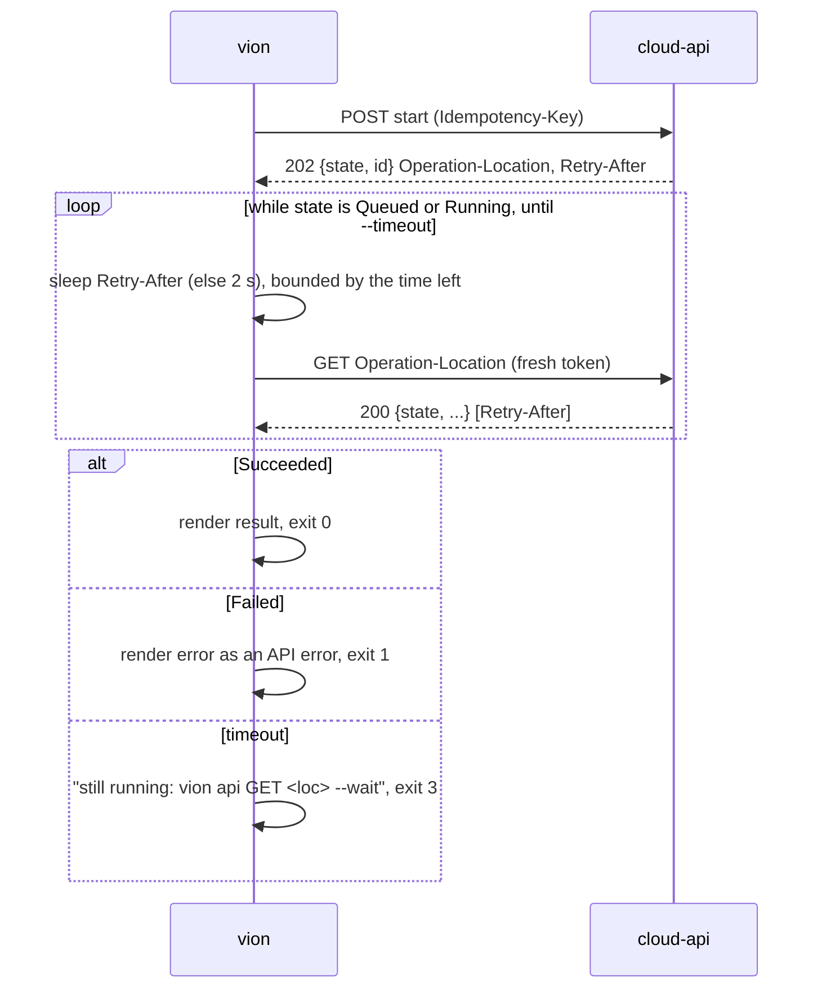

# Wait for a long-running operation; send a raw request as given

> Change doc — one in-flight change. The `Spec delta` below is distilled into the current-truth
> pages under `docs/specs/` in the implementation PR, then this doc is archived
> (`spec-change.ps1 archive <slug>`). Process: `docs/spec-process.md`. Never put change narrative
> inline in a spec page — it lives here.

## At a glance

### Summary

`vion` catches up with two things cloud-api already serves. `--wait` follows a long-running
operation to its end and exits by it — `result` printed and exit 0, `error` reported and exit 1,
still running at the timeout exit 3 — so a job reads one exit code instead of writing a poll loop.
And `vion api` gets a mode that sends the request exactly as given (no minted `Idempotency-Key`, no
`If-Match` read, no dry-run refusal) and a flag that shows the answer's status and headers. The
callers waiting: cloud-api's smoke suite (its 428 check), the test-environment runbook, the bench
commissioning script. Brief: `architecture/.claude/briefs/brief-wait-and-raw-vion-cli.md`.

### Spec implications

`cli.md` gains a section *Waiting for the outcome* (`AC-CLI-008`, new umbrella) after *What comes
back*, two leaves under *The written commands* for `api` (`AC-CLI-006.6`, `.7`), and three
`MODIFIED` criteria: `AC-CLI-003.1`, since `api --include --json` writes a document that is neither
the body nor an error object; `AC-CLI-003.5`, which gains exit 3; `AC-CLI-006.5`, which now names
that `api`'s write-safety headers are the derived command's rules (it said only "render the answer
as any command's"). The help snapshot moves with the new globals and the two `api` options. The
derived table gains two members per operation, read from the document: `completion` and whether
the operation answers a long-running operation. No other page; no invariant.

### Decisions

- `D1` — `--wait` is a **global**, accepted on every command and inert where there is nothing to
  follow — the one flag serves the derived tree and `api` with one spelling, and on a `Response`
  operation the answer already *is* the outcome, so waiting for it is trivially satisfied. Unlike
  `--dry-run`, ignoring it hides nothing: no request changes. (point 1, decide-and-document)
- `D2` — What is followed is derived, never written per operation: a derived command follows when
  its operation is published `completion: LongRunningOperation`, or when it is a `GET` that answers
  `LongRunningOperationOutput` (the handle's own read — the poll, `cloud-api/AC-LRO-001.3` and § The
  long-running operation); `api` follows when the path matches such an operation, or the answer
  carries `Operation-Location`. (constraint 1, points 1 and 6)
- `D3` — The start's answer is the first poll (constraint 3, `cloud-api/AC-LRO-002.3`): its `state`
  decides; `Queued`/`Running` follows `Operation-Location`, else, on the handle's own read, the path
  just read; each answer's `Retry-After` (seconds) is the next delay, two seconds without one.
- `D4` — The timeout is `--timeout <duration>`: `90s`, `15m`, `1h`, or bare seconds; default
  **15 minutes** — cloud-api's run timeout fails a `Running` operation after 10 minutes
  (`LongRunningOperations:RunTimeout`, the archived spec § The runner), and queue time comes on top,
  so a default below it would time out work the server has not given up on. Exit **3** for
  "timed out, still running": 1 is a failed call or a `Failed` operation, 2 a usage error, and a
  script that wants to keep waiting must tell timeout from failure. The name is kubectl's, helm's and
  `az`'s for the same thing (`kubectl wait --timeout`, `helm upgrade --wait --timeout`); kubectl names
  its per-request bound `--request-timeout`, so if `vion` ever exposes its fixed 100-second HTTP
  timeout, that is the name it takes. `--timeout` without `--wait` is a usage error, exit 2: it would
  otherwise read as bounding the call, which it does not. (point 2; name per amendment 1)
- `D5` — A waited command prints `result`, plain and under `--json`, `--fields` projecting it; the
  handle's id is a notice on standard error. `Failed` renders `error` exactly as an API error
  (`AC-CLI-003.4`): table lines on standard error, `{ "error": … }` under `--json`, exit 1. This is
  the archived spec's renderer row (`architecture/specs/archive/2026-11-05-work-off-the-request.md`
  § Published for renderers) and constraint 4 — cited, not relitigated. (point 3, ratified)
- `D6` — A dry run needs no case: its start answers `Succeeded` with the preview as `result`, so
  under D3 the first poll is terminal and the preview is printed. A non-terminal answer with nothing
  to follow (no `Operation-Location`, not a read) is a contract breach, reported as a failure, exit 1.
  (point 4, decide-and-document)
- `D7` — An interrupted wait (Ctrl+C, SIGTERM) and a timed-out one leave the work running and say
  so on standard error with the pick-up line `vion api GET <Operation-Location> --wait`; under
  `--json` the error object carries the last answer as `longRunningOperation`. The interrupted exit
  stays 1 — today's cancellation (`VionCli.cs`, `Guard.cs`) — since a person, not a script, is the
  one interrupting. (point 5, decide-and-document)
- `D8` — `api` takes `--wait` (D1 makes it global) and follows per D2; the pick-up line in D7 relies
  on it. (point 6, decide-and-document)
- `D9` — The raw mode is its own `api` option, **`--no-write-safety`** (name: question 1). It stops
  adding exactly what cloud-api's write-safety page governs and `vion` supplies unasked: the minted
  `Idempotency-Key`, the `If-Match` taken from `meta.version` or a read (and that read itself), the
  removal of `meta` from the body, and the refusal of `--dry-run` on a path that offers none (the
  flag then appends `dryRun=true` as given). `--idempotency-key` and `--if-match` still send what
  they are given. It keeps the token, `Accept`, `User-Agent`, and the irreversible confirmation,
  which changes nothing on the wire. (point 7, decide-and-document but for the name)
- `D10` — Showing the answer's status and headers is a separate `api` option, **`--include`**
  (curl's and `gh api`'s word; name: question 1): the 428 check wants the raw request and no
  headers, the long-running start's verification wants the headers of a normal, safe request.
  Table mode writes `HTTP <status>` and `Name: value` lines to standard output before the body;
  `--json` writes one document `{ "status", "headers", "body" }` for every status, the exit code
  still following the status. `--verbose` stays the trace on standard error. (point 7)
- `D11` — `Operation-Location` is resolved as a URI reference against the environment's API URL
  (RFC 3986), so the host's path base, which it prefixes (cloud-api
  `LongRunningOperationResultFilter.cs:51-62`), is not doubled; an absolute URL on another origin is
  refused before the token is sent. Every poll takes its token as a new call does, so a stored
  sign-in or a service account outlives a long wait; `--token -` reuses the one line it read.
- `D12` — Without `--wait`, an answer that carries `Operation-Location` adds one notice on standard
  error naming it and `--wait`, so a person learns the flag where they need it. The body is
  unchanged.

### Reviewer's questions

1. **[resolved] the names** — Jonas, 2026-11-11, amendment 1: as recommended, except the timeout,
   which is `--timeout` (kubectl, helm, `az`); `--no-write-safety` and `--include`/`-i` stand. Was:
   **(c) propose-and-wait — the four names.** `--wait` is the archived spec's (ratified). The rest
   are mine, and `CLAUDE.md` § STOPs routes a naming question to you:
   - the timeout: a `--wait`-prefixed name (proposed) · **`--timeout`** (chosen; I had objected that
     it reads as the HTTP timeout, which kubectl answers with `--request-timeout`) · `--wait <duration>` (an optional value — `--wait` alone then
     needs a default anyway, and System.CommandLine's optional-arity values swallow the next token);
   - the raw mode: **`--no-write-safety`** (rec.: names exactly what goes, and cloud-api's page is
     `write-safety.md`) · `--raw` (the brief's word, but `api` already has `--raw-field`/`-f`, and
     "raw" says nothing about what is dropped) · `--as-given`;
   - the headers: **`--include`, short `-i`** (rec., curl and `gh api`) · `--show-headers` ·
     folded into the raw mode (rejected in D10: the two callers want different halves).
2. **[resolved] yes, in this pull request** — Jonas, 2026-11-11, amendment 1: `ops` lists
   `completion` as a column beside `effect`, and `ops --live` compares it (`AC-CLI-006.1` modified;
   `AC-CLI-006.2` already names `x-vion-capability` whole and is now true of it). Was:
   **(c) propose-and-wait — `ops` and `ops --live` see `completion`?** Once `completion` is in the
   derived table, `ops` could list it as a flag (`lro`) and `ops --live` could compare it. The second
   is an existing defect: `AC-CLI-006.2` names `x-vion-capability` whole, but the comparison reads
   only `effect`, `idempotent`, `versioned` and `dryRun`, so v0.3.0's refresh reported none of the
   three operations that moved to `202` (`docs/process-journal/2026-11-09-chore-snapshot-long-running-operations.md`).
   Recommendation: fold both in — two lines each once the member is in the table, and the smoke
   suite reads `ops --json`. Alternative: a lane-1 fix after this lands. Not in the delta until you
   choose.
3. **[accepted] (b) the default timeout and exit 3** — D4; amendment 1. The run timeout goes to
   cloud-api as a draft item (publish it). The number rests on cloud-api's 10-minute run
   timeout, which is host configuration and not published; if it moves, nothing tells `vion`.
4. **[accepted] (b) `--wait` inert on `Response`** — D1; amendment 1. The alternative, offering it only on the three
   `LongRunningOperation` commands, puts it in their help alone but fails a script with exit 2 the
   day an operation moves back, and cannot serve `api`, whose operation may be unknown.

None of points 1–7 of the brief's STOP 1 is left open; questions 1 and 2 were answered by
amendment 1 (`architecture/.claude/briefs/brief-wait-and-raw-vion-cli-amendment-1.md`).

---

## Full design

### What the brief assumed, checked

- `completion` is on every operation of the committed `openapi/v1.json`: 266 `Response`, 3
  `LongRunningOperation` (`me.onboarding.provision`, `integrator.edgeGateway.create`,
  `integrator.edgeGatewaySimulation.update`), each declaring a `202` with `Operation-Location`,
  `Retry-After` and `x-vion-longRunningOperationResult`, no `200`. The handle's reads
  (`me.longRunningOperation.get`, `integrator.longRunningOperation.get`) are `Response` and declare
  `Retry-After` on their `200`. No snapshot refresh is part of this change. (Read with a Python
  walk of `openapi/v1.json`, 2026-11-11.)
- `Operation-Location` is an absolute path, `{pathBase}/{root}/{rootId}/longRunningOperations/{id}`
  or `{pathBase}/me/longRunningOperations/{id}` (cloud-api
  `Cloud.Api/LongRunningOperations/LongRunningOperationResultFilter.cs:51-62`); a dry run sends
  neither header (`:34-39`). The 2026-11-09 recording on test is not re-run here — D11 handles a
  path base either way.
- `If-Match` and the key are supplied in `Vion.Cli/Http/WriteSafety.cs` (`AddIdempotencyKey`,
  `AddIfMatchAsync`), reached from `Vion.Cli/Commands/ApiCommand.cs:104-115` whenever the path
  matches a template — as the brief said.
- **The brief's "`vion api` prints no response headers" is half true.** `--verbose` prints every
  response header on standard error (`Vion.Cli/Http/ApiClient.cs:83-90`), and the runbook already
  reads `Operation-Location` that way (`architecture/runbooks/test-environment-checks.md` § Patterns
  that work). What is missing is the headers in `--json`'s one document, apart from the request
  trace and from the `If-Match` read's own answer — which `--include` gives.

### The derived table

`Vion.Cli.Derive` reads two more facts per operation, both from the document, and the emitter
writes them into `Operation`:

- `Completion` — `x-vion-capability.completion`, an enum `Response | LongRunningOperation`; a
  missing member derives as `Response` (the document always carries it, `cloud-api/AC-LRO-001.1`).
- `AnswersLongRunningOperation` — a `2xx` response whose schema references
  `LongRunningOperationOutput`. True on the three starts and the two reads; the two lists answer an
  envelope and are false.

The schema's name is the only thing the derive knows by name, as it knows `x-vion-capability`'s
members; nothing per operation is written.

### The wait

One function, `LongRunningWait`, takes the first answer and a poll path and returns the terminal
answer or throws; both `OperationInvoker` and `ApiCommand` call it after their send, so the rule is
written once. The answer it returns is a synthetic `ApiResponse` — `result` as the body on success,
`error` as the body and the error's `status` on failure — so `Renderer.Render` stays the one renderer
and `--fields`, table and JSON modes hold unchanged. A poll answered with an error (404 after
retention, 401, 5xx) is that error, rendered as any, exit 1, with the pick-up line, since the work may
still be running. No retry of a failing poll: the caller decides, as with any failed call.

The clock and the delay come from `CliServices.Time` (a `TimeProvider`), so tests drive the wait
without sleeping.

### The raw mode and the headers

`ApiCommand` reads the two options. Under `--no-write-safety` it skips the matched operation's
write-safety path — the key, the `If-Match` resolution with its read, `StripMeta`, the dry-run
refusal — and adds a header only from `--idempotency-key` and `--if-match`. The matched operation is
still used for the irreversible confirmation and for `--wait` (D2).

`ApiResponse` gains the response's status reason and headers (content headers included, so
`Content-Type` shows) as an ordered list; `--include` renders them. `ApiClient` already reads every
header for `--verbose`, so this is one more member, not another read.

### Alternatives considered

- `--wait` per command, from `completion` only — question 4.
- Printing the terminal handle rather than `result` — rejected by the archived spec's renderer row.
- Following `Operation-Location` on every answer that carries it, with no table lookup — simpler,
  but constraint 1 says the wait is derived from `completion`; the header-only rule is kept for an
  `api` path the table does not know.
- A separate `vion wait <location>` command — another written command for what `api GET … --wait`
  already says.

### Error model, by exit code

| exit | when |
|---|---|
| 0 | `Succeeded` (a dry run included), or no wait applied and the call succeeded |
| 1 | `Failed`; a poll answered an error; the start's call failed; interrupted; a non-terminal answer with nothing to follow; `Operation-Location` on another origin |
| 2 | usage: a malformed `--timeout`; `--timeout` without `--wait` |
| 3 | still `Queued`/`Running` at `--timeout` |

---

## Drift checkpoints

> One line per divergence discovered during implementation:
> `YYYY-MM-DD: <what changed and why>`. Never inline in a spec page. A checkpoint that fixes a
> CLASS bug states the sibling sweep (done / N/A / handed off).

- 2026-11-11: the brief's "`vion api` … prints no response headers" — `--verbose` prints them on
  standard error; the gap is the `--json` document (§ What the brief assumed, checked).

---

## Spec delta (to distill)

> The machine-readable change, one line per id. Grammar:
> `<OP> <ID> -> <target> : <payload>`
>
> - `OP` ∈ `ADDED` | `MODIFIED` | `REMOVED`
> - `target` is **repo-root-relative** (normally `docs/specs/<page>.md`)
> - `payload`: for `ADDED`/`MODIFIED` the EARS text; for `REMOVED` the reason
>
> On the implementation PR each line is applied into the named target; `spec-change.ps1 archive`
> refuses until every line is applied. The `ID` must be an exact token greppable in the target
> after distill (backticks stripped) — a real `AC-`/`SYS-` id in an area this repo owns, never an
> ad-hoc label and never another repo's area. A criterion the delta declares unreachable carries
> its `GAP: <reason>` marker on the delta line.

- MODIFIED AC-CLI-003.1 -> docs/specs/cli.md : WHERE `--json` is given THE SYSTEM SHALL write exactly one JSON document to standard output, the response body, an object with an `error` member, or under `api --include` an object with `status`, `headers` and `body`, and every notice to standard error.
- MODIFIED AC-CLI-003.5 -> docs/specs/cli.md : THE SYSTEM SHALL exit 0 on success, 1 on a failed call or sign-in, 2 on a usage error, and 3 when a wait ends at its timeout with the work still running.
- MODIFIED AC-CLI-006.1 -> docs/specs/cli.md : WHEN `ops` runs THE SYSTEM SHALL list, from the committed document and without a request, every tree command with its operationId, method, path, effect, completion and flags, and with `--all` the `system` operations too.
- MODIFIED AC-CLI-006.5 -> docs/specs/cli.md : WHEN `api <METHOD> <path>` runs THE SYSTEM SHALL send that request to the environment's API with the resolved token, the `-f` and `-F` pairs as the query on `GET` and as the JSON body otherwise, the write-safety headers and refusals of the operation whose template the path matches, and render the answer as any command's.
- ADDED AC-CLI-006.6 -> docs/specs/cli.md : WHERE `api` is given `--no-write-safety` THE SYSTEM SHALL send the method, path, query and body as given, with `Idempotency-Key` and `If-Match` only from `--idempotency-key` and `--if-match`, reading nothing before the request and refusing no `--dry-run`.
- ADDED AC-CLI-006.7 -> docs/specs/cli.md : WHERE `api` is given `--include` THE SYSTEM SHALL write the answer's status and headers to standard output before the body in table mode, and under `--json` one object with `status`, `headers` and `body` whatever the status.
- ADDED AC-CLI-008.1 -> docs/specs/cli.md : WHERE `--wait` is given and the operation is published `LongRunningOperation`, or is a `GET` answering a long-running operation, THE SYSTEM SHALL read the state from the answer and, while it is `Queued` or `Running`, read `Operation-Location`, else the path just read, again after each answer's `Retry-After` or two seconds, with a token resolved as for a new call, until it is `Succeeded` or `Failed`.
- ADDED AC-CLI-008.2 -> docs/specs/cli.md : WHEN a waited long-running operation ends `Succeeded` THE SYSTEM SHALL render its `result` as the command's answer, name its id as a notice, and exit 0.
- ADDED AC-CLI-008.3 -> docs/specs/cli.md : WHEN a waited long-running operation ends `Failed` THE SYSTEM SHALL report its `error` as an error answer of the API and exit 1.
- ADDED AC-CLI-008.4 -> docs/specs/cli.md : IF a wait reaches `--timeout`, fifteen minutes unless given, with the work `Queued` or `Running` THEN THE SYSTEM SHALL report that it is still running with its `Operation-Location` and `vion api GET <Operation-Location> --wait`, carry the last answer as `longRunningOperation` in the error object under `--json`, and exit 3.
- ADDED AC-CLI-008.5 -> docs/specs/cli.md : IF a wait is interrupted, or a poll answers an error, THEN THE SYSTEM SHALL report that the work may still be running with its `Operation-Location` and the same pick-up command, and exit 1.
- ADDED AC-CLI-008.6 -> docs/specs/cli.md : WHERE `--wait` is given to `api` on a path no long-running operation's template matches THE SYSTEM SHALL wait as for one when the answer carries `Operation-Location`, and otherwise render the answer as without `--wait`.
- ADDED AC-CLI-008.7 -> docs/specs/cli.md : IF `Operation-Location` names an origin other than the environment's API THEN THE SYSTEM SHALL refuse to follow it before sending the token and exit 1.
- ADDED AC-CLI-008.8 -> docs/specs/cli.md : WHEN an answer carries `Operation-Location` and `--wait` is absent THE SYSTEM SHALL name it and `--wait` as a notice.

---

## Tasks

> One-commit tasks, each tagged with ≥1 AC id. Ephemeral — they live and die with this change doc.
> Plain list, no checkboxes — the PR's per-task commits are the completion record.

- `T-001` (`AC-CLI-008.1`): derive `Completion` and `AnswersLongRunningOperation` into the table; regenerate `Operations.g.cs`.
- `T-002` (`AC-CLI-006.7`, `AC-CLI-003.1`): `ApiResponse` carries status reason and headers; `api --include` in both modes.
- `T-003` (`AC-CLI-006.6`, `AC-CLI-006.5`): `api --no-write-safety`.
- `T-004` (`AC-CLI-008.1`–`.8`, `AC-CLI-003.5`): `--wait`, `--timeout`, the shared wait, exit 3, the notice; derived and `api`.
- `T-007` (`AC-CLI-006.1`, `AC-CLI-006.2`): `ops` lists `completion`; `ops --live` compares it — a test red before the change.
- `T-005`: help snapshot via `scripts/derive.ps1`; distill the delta into `cli.md`; archive this doc.
- `T-006`: live check on test per `architecture/runbooks/test-environment-checks.md` — `integrator.edgeGatewaySimulation.update --wait` on a simulated gateway, and `api --no-write-safety` provoking a 428 — or "not run, routes to a human".
