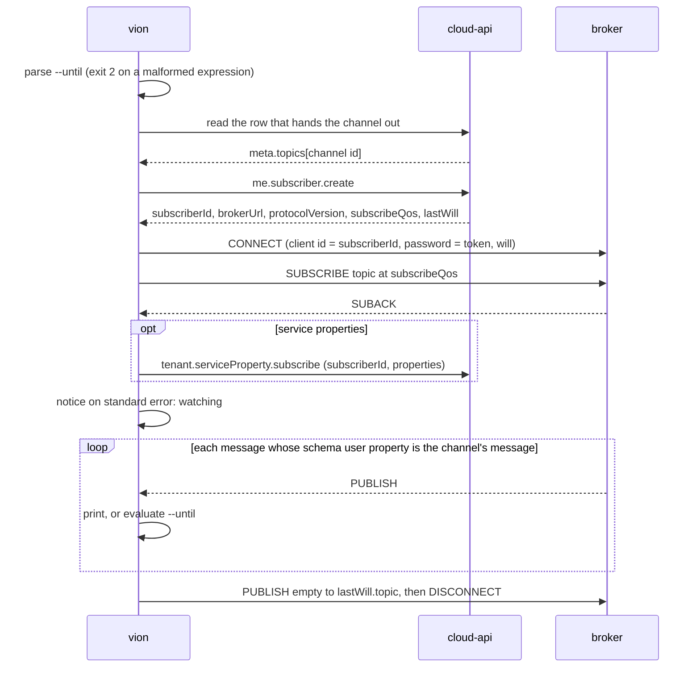

# Watch a channel of the bus until a condition or a timeout

> Change doc — one in-flight change. The `Spec delta` below is distilled into the current-truth
> pages under `docs/specs/` in the implementation PR, then this doc is archived
> (`spec-change.ps1 archive <slug>`). Process: `docs/spec-process.md`. Never put change narrative
> inline in a spec page — it lives here.

## At a glance

### Summary

`vion` 0.5.0 can receive the platform's events, not only send its requests. Every channel
cloud-api's event document publishes for subscribing becomes one command,
`vion <domain> <aggregate> watch`, derived like the rest of the tree. It prints each message until
it is interrupted, until `--timeout`, or until the first message an `--until` condition selects,
and exits by that outcome. The callers waiting: a script or a dispatched session that sets a
property and checks the value arrived, and `vion mcp`, whose sampling tool is a watch with a
timeout. Brief: `architecture/.claude/briefs/brief-vion-watch-vion-cli.md`. This doc is the design
half; a separate session builds from it once ratified.

### Spec implications

A new page `docs/specs/watch.md`, area `WATCH`, anchored by the committed document
`asyncapi/v1.json` and by the watch commands' entries in the help snapshot. `WATCH` moves from
reserved to owned: `_corpus.yml`'s `owns:` and the roster row in `docs/spec-process.md`, in the
implementation PR. Three umbrellas: the tree (`AC-WATCH-001`), subscribing (`AC-WATCH-002`), what
comes back (`AC-WATCH-003`). `cli.md` changes in two criteria only: `AC-CLI-003.1`, since a watch
without a condition writes one JSON document per line, not one document; and `AC-CLI-003.5`, since
exit 3 now also ends a watch whose condition was not met. `--wait`'s criteria (`AC-CLI-008.*`) do
not move. The help snapshot gains the watch commands. No invariant.

### Decisions

Ratified in the design conversation of 2026-11-12 unless marked otherwise.

- `D1` — **What can be watched is what the document publishes**: every channel of
  `asyncapi/v1.json` that some row hands out (`x-vion-handedOutBy`), 18 of the 19 today. The 19th,
  the last will, is one the client writes to. Nothing per channel is written. (ratified)
- `D2` — **A watch lives in the tree**, as the verb `watch` on the channel's aggregate:
  `vion tenant sync-status watch`. The channel id has the operation id's shape
  (`tenant.syncStatus.state` beside `tenant.syncStatus.list`), so the grammar and the context are
  reused and, where the two documents name an aggregate alike, `list` and `watch` sit side by side,
  as `kubectl get` and `get --watch` do (question 4 for where they do not). One command watches one
  channel, so a condition is written against one payload. (ratified; the alternative, a top-level
  `vion watch <channel-id>`, was set aside as a second naming scheme)
- `D3` — **The topic is read from the row, never built.** The committed addresses carry the test
  environment's prefix, and rule 7 of the minimal client says the same. `vion` reads the row that
  hands the channel out and takes `meta.topics[<channel id>]`. (ratified)
- `D4` — **The condition is a standard expression, not a grammar of `vion`'s own.** `--until` takes
  an RFC 9535 (JSONPath) filter expression with `@` standing for the message's payload:
  `--until "@.status=='Completed' && @.objectId=='…'"`. `vion` evaluates the standard query
  `$[?<expression>]` over each message and stops at the first it selects. (ratified; JMESPath was
  set aside for want of a maintained library on `System.Text.Json`. What evaluates the expression
  is question 2)
- `D5` — **The plain stream is the base.** Without `--until`, a watch prints every message, one
  JSON document per line under `--json`, so anything the expression cannot say is a pipe to `jq`.
  (ratified)
- `D6` — **A watch reports messages only.** No synthetic first row, no read of a sibling `list` to
  stand in for the current state. Service properties start with their current value because
  registering makes the gateway send it; the other channels deliver what is published after the
  subscription stands. A readiness notice on standard error tells a script when it may act.
  (ratified: "keep it simple in v1"; the sync-status case has a workaround in
  `tenant.syncStatus.list`)
- `D7` — **`vion` does not know which channel carries a start's outcome.** Tying
  `tenant.logicConfiguration.activate` to its sync status, or a restart to a health update, is not
  written here; whether such starts become long-running operations, and what "active in the cloud,
  never confirmed by the gateway" then means, is cloud-api's design and out of scope. (ratified)
- `D8` — **Question 6 of the work-off-the-request spec: no push channel for operations in this
  change, and `--wait` keeps its one source.** No operation channel is published; the poll works;
  the starts that would gain most from push are the ones under `D7`. If cloud-api later hands out
  an operation channel on a row, its watch command appears by derivation with no change here.
  (propose-and-wait, question 3)
- `D9` — **The connection is the one `me.subscriber.create` describes.** Its answer carries the
  subscriber id, the broker's address, the protocol version, the QoS to subscribe with and the last
  will's topic and QoS, so rules 1, 2, 3 and the broker's address are read, not written. The
  password is the access token from the one token source, resolved again on every connect (rule 5).
  (decide-and-document)
- `D10` — **The order is fixed and repeated after every reconnect**: connect with the will,
  subscribe and await the acknowledgement, register where the channel needs it, then the readiness
  notice. A reconnect says on standard error that messages may have been missed; nothing is
  replayed. (decide-and-document; rule 4 and "the order that matters")
- `D11` — **Every way out unsubscribes**: an empty message to the last will topic, then a clean
  disconnect, on a met condition, a timeout and an interrupt alike (VION-45). The event document's
  `LastWill` message says a client "never publishes it itself"; the minimal client, the brief and
  the broker's write grant on that topic say it does, and a clean disconnect fires no will. `vion`
  follows the latter and the sentence is reported. (decide-and-document)
- `D12` — **`asyncapi/v1.json` is committed at the root, pulled by its own script**, and the
  channel table is emitted beside the operation table by the same derive step, held by
  `derive.ps1 -Verify` (architecture decision 0280). (ratified by 0280)
- `D13` — **Exit codes follow the tool's.** A met condition is 0; a timeout with the condition
  unmet is 3; a plain stream that reaches its `--timeout` or is interrupted is 0, since it did what
  was asked; an interrupted watch with a condition is 1; a refused connection or subscription is 1;
  a malformed `--until` is 2, before anything is sent. (decide-and-document, questions 4 and 5)
- `D14` — **What is new under NativeAOT is the build's first task and its named STOP.** MQTTnet 5
  over WebSockets, and the expression evaluator question 2 settles, are published in this repo's
  own build before anything rests on them. A trim or AOT warning is a STOP with the warning pasted:
  the named fallback for the evaluator is 0.5.0 without `--until`; MQTTnet has none.
  (decide-and-document)
- `D15` — **`user` channels sit under `me`.** The tree's name for the caller's own domain is `me`;
  the one channel id that starts `user` (`user.notifications.event`) is handed out by `/me`'s row.
  (decide-and-document; reported to cloud-api as an inconsistency of names, not blocking)
- `D16` — **An address parameter every hand-out leaves open is no option.** The alert channel is
  handed out only as the gateway's filter over all its rules, so `tenant alert watch` takes
  `--edge-gateway-id` and no `--alert-rule-id`; one rule is `--until "@.alertRuleId=='…'"`. An
  option that could not narrow the subscription would promise what it does not do.
  (decide-and-document)
- `D17` — **`--property` registers; it does not filter, and it is checked.** State is published per
  service, so a watch prints what the bus delivers on that topic, another subscriber's properties
  included. A name the service row does not carry is refused before connecting, exit 2: cloud-api
  drops an unknown property silently and the watch would otherwise sit to its timeout.
  (decide-and-document)
- `D18` — **The command prints the payload; the runner hands on the topic too.** Standard output
  stays the published schema and nothing else. The sink behind the command receives each message
  with its topic, so that a later caller can tell a wildcard watch's sources apart where the
  payload does not name its gateway, as `SupportAccessGrantStatusUpdate` does not.
  (decide-and-document)

### Reviewer's questions

Ordered by how much of the build turns on each.

1. **(c) The document does not say which row a channel's parameters name.** `x-vion-handedOutBy`
   gives the row's schema and its `meta.topics` key, and where the row hands out a filter the
   parameters left open (keys found: `schema`, `key`, `wildcards`). The channel's parameter
   `edgeGatewayId` is the gateway row's `id` and the alert rule row's `edgeGatewayId`;
   `serviceIdentifier` is the service row's `identifier`. Without that join `vion` cannot pick the
   row from the options, so `D3` cannot be derived. The same document already publishes exactly
   such a join for property values (`x-vion-valueSchema`: `operation`, `member`, `join`). Options:
   - **A — cloud-api publishes the join** on each `x-vion-handedOutBy` entry: the operation that
     reads the row and, per channel parameter, the operation parameter or row member it equals. The
     build of the watch commands waits on that release and a snapshot pull.
   - **B — `vion` carries the join in `cli.json`**, five entries today, hand-kept until A exists.
     That puts a fact of the API in the presentation file, against decision 0264.
   - **C — `vion` matches the options against the handed-out topic's segments.** It needs the
     address template's shape to hold across environments, which nothing publishes.

   Recommendation: **A**. It is a hedge of the brief that failed, so by the brief it is reported
   and not designed around. OUTCOME: _open_
2. **(c) What evaluates the `--until` expression.** JsonPath.Net, the one maintained RFC 9535
   implementation on `System.Text.Json` with filters, ships its NuGet binaries under a maintenance
   fee agreement: an organisation with annual revenue of US$10,000 or more pays, the source stays
   MIT. Read from the package's licence page in a search result on 2026-11-12, not from the
   agreement's full text; what it means for a binary `vion` redistributes is not established.
   Options:
   - **A — pay the fee and reference the package**, after the agreement is read in full. Least
     code.
   - **B — an evaluator in this repo for the standard's filter expression**, whole and nothing
     added, held by the public JSONPath compliance test suite's filter cases. No dependency and no
     terms; the cost is one parser and evaluator over `JsonNode` to keep, for a grammar an RFC has
     frozen. This is not `D4`'s rejected alternative: the language stays the standard's.
   - **C — build JsonPath.Net from its MIT source.** No fee by the agreement's own wording, and a
     vendored build to keep in step by hand.
   - **D — 0.5.0 without `--until`**: the plain stream only, the awaiting half deferred.

   Recommendation: **B**, unless the fee and its terms for a redistributed binary turn out plainly
   acceptable on reading, in which case A. OUTCOME: _open_
3. **(c) The property registration is the one step the document does not declare.** That
   `tenant.serviceProperties.state` needs `tenant.serviceProperty.subscribe` after the broker's
   acknowledgement is stated in prose on the operation, not as a fact on the channel. Options:
   **A** — written once in `vion`, keyed on the channel id, with `--property` naming the
   properties, and the gap reported so that the document can declare it later; **B** — the watch of
   service properties waits until the document declares it. Recommendation: **A**: it is the use
   that matters most, and one written step named for what it is beats none. OUTCOME: _open_
4. **(c) Three watch commands do not sit beside their operations, and the names are public from
   0.5.0.** The channel ids and the operation ids name the aggregate differently:
   `tenant service-properties watch` beside `tenant service-property set`;
   `me notifications watch` beside `me notification list`; `integrator deployment watch` beside
   `integrator software-deployment list`. Options: **A** — ship the names as derived and report the
   three to cloud-api, a later rename there arriving as a reviewed diff of the snapshot and a
   breaking change of a 0.x tool; **B** — alias the three in `cli.json`, which then has to learn
   channel ids; **C** — hold the three commands until cloud-api renames. Recommendation: **A**: the
   document is the one source of names, and a hand-kept alias hides the inconsistency from the
   repo that can fix it. OUTCOME: _open_
5. **(c) With `--until`, standard output carries the selecting message only**, so
   `$(vion … watch --until … --json)` is one document and `AC-CLI-003.1` holds for it as written.
   The messages before it are not printed. The alternative prints every message up to the selecting
   one, which shows progress but makes a script cut the last line. Recommendation: the selecting
   message only; a person who wants progress runs the plain stream. OUTCOME: _open_
6. **(c) Timeouts.** A plain stream has no default bound and ends 0 at a given `--timeout`, which
   is the sampling the MCP tool needs. With `--until` the default is `--wait`'s fifteen minutes and
   an unmet condition ends 3. `--timeout` on a watch therefore stands without `--wait`, where on
   every other command it stays a usage error. Recommendation: accept. OUTCOME: _open_
7. **(c) `D8`: no push channel for operations, `--wait` unchanged.** Recommendation: accept.
   OUTCOME: _open_

---

## Full design

### What was checked, and how

- **The test environment serves the committed event document.** `GET
  https://api.test.vion.swiss/asyncapi/v1.json` compared equal, as parsed JSON, to cloud-api's
  `scripts/asyncapi-v1.json` at `162ed3bc`, on 2026-11-12.
- **The token `vion` holds carries what the broker asks for — by its claims, not by a
  subscription.** The stored device-grant access tokens for `test` and `production` were decoded:
  audience includes `rabbitmq` and `cloud-api`, scope includes `web_mqtt_access` and `api_access`,
  and the `oid` claim the broker names the connection by is present. `auth login` already requests
  `web_mqtt_access` (`AC-CLI-004.1`). No live subscription was made in the design session: it has
  no MQTT client. The build's first live check is that subscription, and a refusal there is a STOP.
- **No retained publish was found in cloud-api.** A search for `retain` over its `.cs` files finds
  no publish option. Inferred, not observed on the broker; `D6` rests on it only for what its help
  says.

### The surface

```
vion tenant sync-status watch --edge-gateway-id <id>
vion tenant system-health watch --edge-gateway-id <id> \
     --until "@.components[?@.name=='mesh' && @.healthStatus=='Healthy']" --timeout 5m
vion tenant service-properties watch --edge-gateway-id <id> \
     --service-provider-identifier <p> --service-identifier <s> --property Setpoint \
     --until "@.propertiesState[?@.propertyIdentifier=='Setpoint' && @.value==21.5]"
vion integrator deployment watch                     # every gateway of the integrator
vion tenant alert watch --edge-gateway-id <id> --until "@.alertRuleId=='<rule>'"
vion me notifications watch --json | jq …
```

The command is `<domain> <aggregate> watch`: the channel id's first two segments in kebab case,
its third segment (`state`, `event`) dropped, `user` shown as `me` (`D15`). Two channels that derive
to one command, or a channel whose command an operation already has, fail the derive naming both,
as a `cli.json` entry without its operation does (`AC-CLI-001.5`).

Options are the channel's address parameters in kebab case. Left out: `tenantId`, `integratorId`,
`platformId` and `projectId`, which the context supplies exactly as for an operation
(`AC-CLI-001.3`), and `identityProviderUserId`, which is the caller. A parameter is required unless
a hand-out lists it under `wildcards`: the integrator channels are handed out per gateway by the
gateway row and for all gateways by the caller's membership row, so `--edge-gateway-id` is optional
there and absent means the filter. A parameter every hand-out leaves open is no option at all
(`D16`): the alert channel's only hand-out is the alert rule row's filter over the gateway's
rules, so any alert rule row of that gateway yields the topic, and a gateway without a rule has no
row to hand it out — exit 1 by `AC-WATCH-002.1`, and reported to cloud-api.

Two options are the watch's own, on every watch command: `--until <expression>` and, on the
service-properties command only, `--property <identifier>`, repeatable, all of the service's
properties when absent, each checked against the service row's `properties[].identifier` before
connecting (`D17`). `--timeout`, `--json` and `--fields` are the globals. `--dry-run` is
refused as on any operation that does not offer it; `--wait` is inert, as on any command with
nothing to follow.

Help: the document carries no description on any channel (0 of 19), only on address parameters. A
watch command's help line is therefore a written template over derived facts, "Watch
`<MessageName>` messages on `<channel id>`.", and its options take the parameters' descriptions.
Reported to cloud-api; when channels gain descriptions the template gives way to them.

### The run



- **The row.** Which operation reads it and which option picks it is question 1. Under option A
  both are read from the channel table. A row that is not found, or that hands out no topic under
  the channel's id (the caller may read the row and not the channel), ends the command with exit 1
  naming the row and the channel, before any connection.
- **The subscriber.** `me.subscriber.create` once per run. A caller with no broker user, such as a
  platform service account, is answered 409, which is reported as any API error and exits 1.
- **The connection.** MQTT 5 over secure WebSockets to `brokerUrl`; empty username; the access
  token as password, taken from the token source of `AC-CLI-004.4` at every connect, so a
  reconnect after expiry presents a fresh one. A token handed in by `--token -` cannot be
  refreshed: a reconnect after its expiry is refused by the broker and ends the command.
- **Refusal against loss.** A CONNECT or SUBSCRIBE the broker refuses ends the command with exit 1
  and the reason code; the broker closes a connection whose subscription it refuses, so a close
  between SUBSCRIBE and SUBACK is read as that refusal. A connection lost after the readiness
  notice is reconnected with a backoff from one second to thirty, for as long as the timeout
  allows, with one notice per loss saying that messages may have been missed. This is
  `kubectl get --watch`'s `410 Gone`: the stream says it has a hole, and re-reading the state is
  the caller's.
- **The schema check.** A message is taken only when its `schema` user property equals the
  channel's message name (rule 6); any other is dropped without output.
- **The way out.** Condition met, timeout, Ctrl+C and SIGTERM all pass one exit path: the empty
  message to `lastWill.topic` at `lastWill.qos`, the DISCONNECT, then the exit code. A second
  interrupt during it exits at once and leaves the will to the broker.

### The condition

`--until` is parsed before anything is sent. The expression is the *logical-expr* of RFC 9535
§ 2.3.5 as written, with `@` bound to the message's payload: comparisons, `&&`, `||`, `!`,
existence tests and nested filters are the standard's. `vion` wraps the payload in a one-element
array and runs `$[?<expression>]`; a non-empty result selects the message. Each message is judged
alone; there is no state across messages.

The expression carries no `$`, so it sits in plain double quotes in bash and PowerShell alike.

Output with a condition is the selecting message, rendered as any single answer and projected by
`--fields`, exit 0 (question 4). Reaching the timeout first writes an error answer saying no
message met the condition, with the count of messages seen, and exits 3.

### Output without a condition

Under `--json`, each message is its payload on one line, as received, projected by `--fields`
where given. In table mode each message is rendered as any object is (`AC-CLI-003.3`'s key–value
table), one after another. Notices — watching, reconnected — go to standard error in both modes.
The payload alone is printed, without an envelope of topic and time: an envelope would put
`vion`'s own shape between the caller and the published schema. Most payloads name their gateway;
`SupportAccessGrantStatusUpdate` does not, so on the integrator's wildcard watch of that channel
the source is not on standard output. The runner's sink receives the topic all the same (`D18`),
and an option that prints it is a later change, not this one.

### The derived layer

- `asyncapi/v1.json`, pulled by `scripts/asyncapi-pull.ps1` from the same environment and with the
  same normalisation as `scripts/snapshot-pull.ps1` (precedent to copy). Each snapshot keeps its own
  script (decision 0280).
- `Vion.Cli.Derive` reads both documents and emits `Vion.Cli/Derived/Channels.g.cs` beside
  `Operations.g.cs`: per channel its id, command path, message name, parameters with descriptions
  and whether a hand-out leaves each open, and per hand-out the row's schema, key and, under
  question 1's option A, the reading operation and the join.
- `scripts/derive.ps1` and its `-Verify` cover the new file and the help snapshot's new commands;
  the `derive` job of `gates.yml` holds both.
- `ops` lists operations and stays so. Whether it grows a channels view is not part of this change.

### What `vion mcp` gets from this, and no more

The MCP mode comes next and is not designed here. This change bounds it in three ways:

1. A sampling tool is one watch command with a timeout and no condition; an awaiting tool is the
   same with `--until`. So the watch runs behind one entry point that takes a channel row, the
   option values, an optional expression and a timeout, and hands each message, with its topic,
   to a sink it is given.
   It does not write to the console itself. The command is one caller of it, the MCP tool the next.
2. The outcome is a value, not an exit code inside the runner: selected, timed out, ended,
   refused. The command maps it to 0, 3, 0, 1.
3. The channel table carries the message name and the parameters' descriptions, which is what a
   tool's description and input schema are built from.

### Alternatives set aside

- **A grammar of `vion`'s own for the condition** (`status=Completed`, `list[member=value].x=y`).
  No dependency and no quoting, but a language to maintain that grows one operator at a time.
- **No condition, only the pipe.** With `… | jq | head -1` the exit code is the pipe's and `vion`
  learns the reader is gone only at its next write; on a quiet channel it sits until the timeout
  and unsubscribes late.
- **A first row read from the sibling `list`.** The list's row and the channel's payload are not
  declared to have one shape, so a condition could silently not apply to the first row.
- **`--watch` as a global on `list`.** One row hands out up to eight channels; a caller wants one.

### Reported to cloud-api, none patched here

1. `x-vion-handedOutBy` lacks the reading operation and the parameter join (question 1). Blocking
   under option A.
2. No fact declares that `tenant.serviceProperties.state` is registered through
   `tenant.serviceProperty.subscribe` (question 2).
3. No channel carries a description.
4. A state channel delivers nothing on subscribe and no fact names the read that holds its current
   state (`D6`).
5. No fact links a start to the channel its outcome arrives on; whether such starts become
   long-running operations is an open design there (`D7`).
6. One channel id starts `user` where the operations' domain is `me` (`D15`).
7. Three channels name their aggregate differently from its operations (question 4).
8. The `LastWill` message's description says a client never publishes the will; the minimal
   client and the broker's grant say it does on a clean exit (`D11`).
9. The alert channel's filter is handed out by alert rule rows only, so a gateway without a rule
   hands it out nowhere (`D16`).

---

## Drift checkpoints

> One line per divergence discovered during implementation:
> `YYYY-MM-DD: <what changed and why>`. Never inline in a spec page. A checkpoint that fixes a
> CLASS bug states the sibling sweep (done / N/A / handed off).

- _(none yet — append as implementation diverges from Full design)_

---

## Spec delta (to distill)

> The machine-readable change, one line per id. Grammar:
> `<OP> <ID> -> <target> : <payload>`
>
> - `OP` ∈ `ADDED` | `MODIFIED` | `REMOVED`
> - `target` is **repo-root-relative** (normally `docs/specs/<page>.md`)
> - `payload`: for `ADDED`/`MODIFIED` the EARS text; for `REMOVED` the reason
>
> On the implementation PR each line is applied into the named target; `spec-change.ps1 archive`
> refuses until every line is applied. The `ID` must be an exact token greppable in the target
> after distill (backticks stripped) — a real `AC-`/`SYS-` id in an area this repo owns, never an
> ad-hoc label and never another repo's area. A criterion the delta declares unreachable carries
> its `GAP: <reason>` marker on the delta line.

- ADDED AC-WATCH-001.1 -> docs/specs/watch.md : (Ubiquitous): THE SYSTEM SHALL offer one command `vion <domain> <aggregate> watch` for every channel of the committed document `asyncapi/v1.json` that a row hands out, the domain and aggregate being the channel id's first two segments in kebab case with `user` named `me`, and no watch command for any other channel.
- ADDED AC-WATCH-001.2 -> docs/specs/watch.md : (Ubiquitous): THE SYSTEM SHALL take every address parameter of a channel as an option named by the parameter's name in kebab case and described by its description, except `tenantId`, `integratorId`, `platformId` and `projectId`, which the context supplies, `identityProviderUserId`, which is the caller's, and a parameter every hand-out of the channel leaves open, requiring each unless some hand-out of the channel leaves it open.
- ADDED AC-WATCH-001.3 -> docs/specs/watch.md : (Unwanted): IF two channels derive to one command, or a channel derives to a command an operation has, THEN THE SYSTEM SHALL fail the derive step naming both.
- ADDED AC-WATCH-002.1 -> docs/specs/watch.md : (Event-driven): WHEN a watch command runs THE SYSTEM SHALL read the row that hands the channel out, subscribe to the topic that row carries in `meta.topics` under the channel's id, and, where no row matches the options or the row carries no such topic, refuse before connecting, naming the row and the channel, and exit 1.
- ADDED AC-WATCH-002.2 -> docs/specs/watch.md : (Event-driven): WHEN a watch command connects THE SYSTEM SHALL connect to the broker, with the client id, protocol version and last will, and subscribe at the quality of service, that `me.subscriber.create` answers, presenting an empty username and the token resolved at that connect as the password.
- ADDED AC-WATCH-002.3 -> docs/specs/watch.md : (Optional): WHERE the channel is `tenant.serviceProperties.state` THE SYSTEM SHALL, once the broker has acknowledged the subscription, register with `tenant.serviceProperty.subscribe` under the subscriber's id each property `--property` names, or every property of the service where none is named.
- ADDED AC-WATCH-002.8 -> docs/specs/watch.md : (Unwanted): IF `--property` names a property the service's row does not carry THEN THE SYSTEM SHALL refuse before connecting, naming it, and exit 2.
- ADDED AC-WATCH-002.4 -> docs/specs/watch.md : (Event-driven): WHEN the broker has acknowledged the subscription and, where the channel is registered, the registration has answered THE SYSTEM SHALL write one notice to standard error that it is watching, naming the channel.
- ADDED AC-WATCH-002.5 -> docs/specs/watch.md : (Unwanted): IF the connection is lost after that notice THEN THE SYSTEM SHALL connect again with the token resolved again, subscribe and register again in that order, and write a notice to standard error that messages may have been missed.
- ADDED AC-WATCH-002.6 -> docs/specs/watch.md : (Unwanted): IF the broker refuses the connection or the subscription THEN THE SYSTEM SHALL report the refusal with its reason and exit 1.
- ADDED AC-WATCH-002.7 -> docs/specs/watch.md : (Event-driven): WHEN a watch ends, by its condition, its timeout or an interrupt, THE SYSTEM SHALL publish an empty message to the last will's topic and then disconnect from the broker before it exits.
- ADDED AC-WATCH-003.1 -> docs/specs/watch.md : (Ubiquitous): THE SYSTEM SHALL write each message whose `schema` user property names the channel's message, and no other message, as its payload on one line of standard output under `--json` and as an object's key–value table otherwise, projected by `--fields` in both.
- ADDED AC-WATCH-003.2 -> docs/specs/watch.md : (Optional): WHERE `--until` is given THE SYSTEM SHALL evaluate its value as an RFC 9535 filter expression with `@` bound to the payload against each message alone, write only the first message it selects, as any single answer, and exit 0.
- ADDED AC-WATCH-003.3 -> docs/specs/watch.md : (Unwanted): IF `--until`'s value is not an RFC 9535 filter expression THEN THE SYSTEM SHALL refuse before sending anything and exit 2.
- ADDED AC-WATCH-003.4 -> docs/specs/watch.md : (Unwanted): IF a watch given `--until` reaches `--timeout`, fifteen minutes unless given, with no message selected THEN THE SYSTEM SHALL report that no message met the condition, with the number of messages seen, and exit 3.
- ADDED AC-WATCH-003.5 -> docs/specs/watch.md : (Optional): WHERE `--until` is absent THE SYSTEM SHALL watch until `--timeout` where one is given and until interrupted otherwise, and exit 0 at either.
- ADDED AC-WATCH-003.6 -> docs/specs/watch.md : (Unwanted): IF a watch given `--until` is interrupted with no message selected THEN THE SYSTEM SHALL exit 1.
- MODIFIED AC-CLI-003.1 -> docs/specs/cli.md : (Optional): WHERE `--json` is given THE SYSTEM SHALL write exactly one JSON document to standard output, the response body, an object with an `error` member, or under `api --include` an object with `status`, `headers` and `body`, or, on a watch without `--until`, one JSON document per line, and every notice to standard error.
- MODIFIED AC-CLI-003.5 -> docs/specs/cli.md : (Ubiquitous): THE SYSTEM SHALL exit 0 on success, 1 on a failed call or sign-in, 2 on a usage error, and 3 when a wait ends at its timeout with the work still running or a watch's condition is unmet at its timeout.

---

## Tasks

> One-commit tasks, each tagged with ≥1 AC id. Ephemeral — they live and die with this change doc.
> Plain list, no checkboxes — the PR's per-task commits are the completion record.

The build session re-cuts these once question 1 is answered; under option A, `T-003` onward wait
on cloud-api's release and a pull.

- `T-001` (`AC-WATCH-002.2`, `AC-WATCH-003.2`): reference MQTTnet 5 and whatever question 2 settles, publish under NativeAOT with zero warnings, and make one read-only subscription on test with a device-grant token. STOP on a warning or a refusal (`D14`).
- `T-002` (`AC-WATCH-001.1`): commit `asyncapi/v1.json` with `scripts/asyncapi-pull.ps1`; add `WATCH` to `_corpus.yml`'s `owns:` and the roster; open `docs/specs/watch.md`.
- `T-003` (`AC-WATCH-001.1`, `AC-WATCH-001.2`, `AC-WATCH-001.3`): derive `Channels.g.cs` and the watch commands; `derive.ps1 -Verify` and the help snapshot cover them.
- `T-004` (`AC-WATCH-002.1`): resolve the row and its topic.
- `T-005` (`AC-WATCH-002.2`, `AC-WATCH-002.4`, `AC-WATCH-002.6`, `AC-WATCH-002.7`): the runner — subscriber, connect, subscribe, readiness notice, refusal, the way out.
- `T-006` (`AC-WATCH-003.1`, `AC-WATCH-003.5`, `AC-CLI-003.1`): the plain stream, its rendering and its end.
- `T-007` (`AC-WATCH-003.2`, `AC-WATCH-003.3`, `AC-WATCH-003.4`, `AC-WATCH-003.6`, `AC-CLI-003.5`): the condition and its exits.
- `T-008` (`AC-WATCH-002.3`, `AC-WATCH-002.8`): the property registration and `--property`.
- `T-009` (`AC-WATCH-002.5`): reconnect, in order, with its notice.
