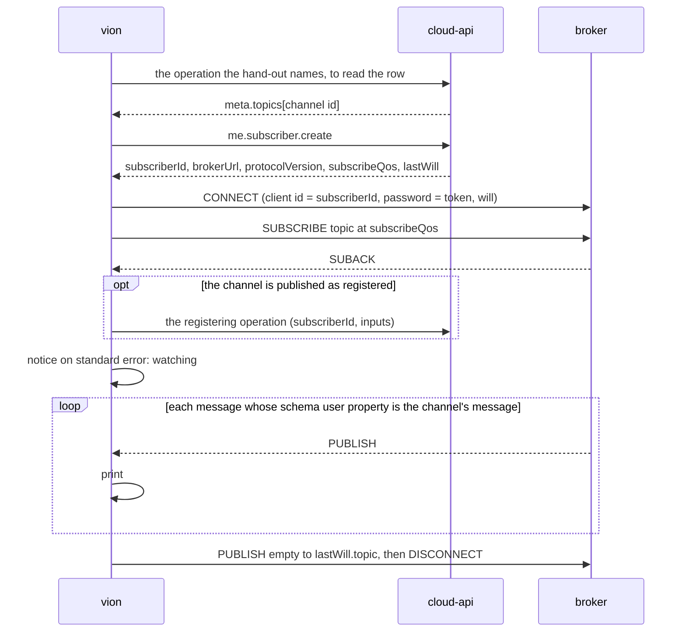

# Watch a channel of the bus until a timeout

> Change doc — one in-flight change. The `Spec delta` below is distilled into the current-truth
> pages under `docs/specs/` in the implementation PR, then this doc is archived
> (`spec-change.ps1 archive <slug>`). Process: `docs/spec-process.md`. Never put change narrative
> inline in a spec page — it lives here.

## At a glance

### Summary

`vion` 0.5.0 can receive the platform's events, not only send its requests. Every channel
cloud-api's event document publishes for subscribing becomes one command,
`vion <domain> <aggregate> watch`, derived like the rest of the tree. It prints each message, one
JSON document per line under `--json`, until it is interrupted or `--timeout` ends it. Nothing per
channel is written in `vion`; where the document does not yet carry a fact the derivation needs,
cloud-api publishes it first (§ The prequel, shipped as cloud-api #269). A stop
condition, `--until`, is deferred to its own change. The callers waiting: a script or a dispatched
session that sets a property and reads the value back, and `vion mcp`, whose sampling tool is a
watch with a timeout. Brief: `architecture/.claude/briefs/brief-vion-watch-vion-cli.md`. This doc
is the design half; a separate session builds from it.

### Spec implications

A new page `docs/specs/watch.md`, area `WATCH`, anchored by the committed document
`asyncapi/v1.json` and by the watch commands' entries in the help snapshot. `WATCH` moves from
reserved to owned: `_corpus.yml`'s `owns:` and the roster row in `docs/spec-process.md`, in the
implementation PR. Three umbrellas: the tree (`AC-WATCH-001`), subscribing (`AC-WATCH-002`), what
comes back (`AC-WATCH-003`). `cli.md` changes in one criterion: `AC-CLI-003.1`, since a watch
writes one JSON document per line, not one document. The exit codes (`AC-CLI-003.5`) and `--wait`'s
criteria (`AC-CLI-008.*`) do not move. The help snapshot gains the watch commands. No invariant.

### Decisions

Ratified by Jonas in the design conversation of 2026-11-12 unless marked otherwise.

- `D1` — **What can be watched is what the document publishes**: every channel of
  `asyncapi/v1.json` that some row hands out (`x-vion-handedOutBy`), 18 of the 19 today. The 19th,
  the last will, is one the client writes to. (ratified)
- `D2` — **A watch lives in the tree**, as the verb `watch` on the channel's aggregate:
  `vion tenant sync-status watch`. The channel id has the operation id's shape
  (`tenant.syncStatus.state` beside `tenant.syncStatus.list`), so the grammar and the context are
  reused and `list` and `watch` sit side by side, as `kubectl get` and `get --watch` do. One
  command watches one channel. (ratified; a top-level `vion watch <channel-id>` was set aside as a
  second naming scheme)
- `D3` — **Nothing per channel is written, and no gap is worked around.** Where the document lacks
  a fact the derivation needs, cloud-api publishes the fact and `vion` waits for it: no hand-kept
  join in `cli.json`, no channel id known by name, no written name mapping, no help template.
  (ratified: "no workarounds or shortcuts")
- `D4` — **The topic is read from the row, never built.** The committed addresses carry the test
  environment's prefix, and rule 7 of the minimal client says the same. `vion` reads the row that
  hands the channel out and takes `meta.topics[<channel id>]`. (ratified)
- `D5` — **Version one is the plain stream.** A watch prints every message until interrupted or
  `--timeout`; under `--json` one document per line, so a condition is a pipe to `jq`. (ratified)
- `D6` — **`--until` is deferred to its own change, its direction recorded.** A stop condition is a
  standard expression, an RFC 9535 (JSONPath) filter with `@` standing for the payload, never a
  grammar of `vion`'s own. What evaluates it is decided in that change: the one maintained library
  with filters on `System.Text.Json`, JsonPath.Net, ships its binaries under a maintenance fee
  agreement for organisations with annual revenue of US$10,000 or more (read from the package's
  licence page in a search result, not from the agreement's full text), and the alternative is an
  evaluator in this repo held by the public JSONPath compliance suite. (ratified: deferred)
- `D7` — **A watch reports messages only.** No synthetic first row, no read of a sibling `list` to
  stand in for the current state. Service properties start with their current value because
  registering makes the gateway send it; the other channels deliver what is published after the
  subscription stands. A readiness notice on standard error tells a script when it may act.
  (ratified: "keep it simple in v1"; sync status has `tenant.syncStatus.list` for the current
  state)
- `D8` — **`vion` does not know which channel carries a start's outcome.** Tying
  `tenant.logicConfiguration.activate` to its sync status, or a restart to a health update, is not
  written here; whether such starts become long-running operations, and what "active in the cloud,
  never confirmed by the gateway" then means, is cloud-api's design and out of scope. (ratified)
- `D9` — **Question 6 of the work-off-the-request spec: no push channel for operations, and
  `--wait` keeps its one source.** Operations are polled by `--wait` already. If cloud-api later
  hands out an operation channel on a row, its watch command appears by derivation with no change
  here. (ratified)
- `D10` — **The connection is the one `me.subscriber.create` describes.** Its answer carries the
  subscriber id, the broker's address, the protocol version, the QoS to subscribe with and the last
  will's topic and QoS, so rules 1, 2 and 3 of the minimal client and the broker's address are
  read, not written. The password is the access token from the one token source, resolved again on
  every connect (rule 5). (decide-and-document)
- `D11` — **The procedure is written once, its triggers are derived**, as `--wait` writes the poll
  once and reads `completion: LongRunningOperation` off the document. The order is fixed and
  repeated after every reconnect: connect with the will, subscribe and await the acknowledgement,
  register where the channel is published as registered, then the readiness notice. A reconnect
  says on standard error that messages may have been missed; nothing is replayed.
  (decide-and-document; rule 4 and "the order that matters")
- `D12` — **Every way out unsubscribes**: an empty message to the last will topic, then a clean
  disconnect, on a timeout and an interrupt alike (VION-45). The event document says so of the
  will since the prequel, and `cloud-api/AC-BUS-010.2` grants the write. (decide-and-document)
- `D13` — **`asyncapi/v1.json` is committed at the root, pulled by its own script**, and the
  channel table is emitted beside the operation table by the same derive step, held by
  `derive.ps1 -Verify` (architecture decision 0280). (ratified by 0280)
- `D14` — **A watch that stood exits 0 when it ends as asked**, at its `--timeout` or on an
  interrupt; one ended before it stood exits 1 (drift checkpoint 16). It exits 1 too
  on a refused connection or subscription or a row that hands out no topic. There is no default
  timeout. `--timeout` on a watch stands without `--wait`; on every other command it stays the
  usage error it is. (ratified with the version-one cut)
- `D15` — **MQTTnet under NativeAOT is the build's first task and its named STOP.** MQTTnet 5 over
  WebSockets is published in this repo's own build, and one read-only subscription is made on test
  with a device-grant token, before anything rests on either. A trim or AOT warning, or a refusal
  by the broker, is a STOP with the output pasted. There is no fallback. (decide-and-document)
- `D16` — **An option is an address parameter that selects the row; no other parameter is one.**
  A hand-out's `join` says which parameters pick its row. The alert channel is handed out only as
  a filter over all of a gateway's rules, so no hand-out joins `alertRuleId` and
  `tenant alert watch` takes `--edge-gateway-id` alone; the caller's own id is joined to the one
  row `/me` answers, which nothing has to select, so it is no option either. An option that could
  not narrow the subscription would promise what it does not do. (decide-and-document; restated
  on the shipped join, drift checkpoint 2)
- `D19` — **Where several hand-outs fit, the first in document order is read.** A hand-out fits
  when the options given are exactly the parameters it joins to select its row. The alert channel
  is handed out by the gateway row and by each alert rule row, both by gateway; the gateway row
  comes first and is one row. (decide-and-document, drift checkpoint 3)
- `D17` — **A registration input registers; it does not filter, and it is checked.** State is
  published per service, so a watch prints what the bus delivers on that topic, another
  subscriber's properties included. A value the row does not carry is refused before connecting,
  exit 2: cloud-api drops an unknown property silently and the watch would otherwise print
  nothing. (decide-and-document)
- `D18` — **The command prints the payload; the runner hands on the topic too.** Standard output
  stays the published schema and nothing else. The sink behind the command receives each message
  with its topic, so that a later caller can tell a wildcard watch's sources apart where the
  payload does not name its gateway, as `SupportAccessGrantStatusUpdate` does not.
  (decide-and-document)

### Reviewer's questions

1. **The document does not say which row a channel's parameters name.** Options were: cloud-api
   publishes the join; `vion` carries it in `cli.json`; `vion` matches topic segments.
   OUTCOME: cloud-api publishes it, prequel item 1 (Jonas, 2026-11-12: no workarounds).
2. **What evaluates the `--until` expression**, given JsonPath.Net's maintenance fee.
   OUTCOME: moot for this change; `--until` is deferred and the question moves with it, `D6`
   (Jonas, 2026-11-12).
3. **The property registration is declared nowhere in the document.** Options were: written once
   in `vion`, keyed on the channel id; or declared by the document.
   OUTCOME: changed from the session's recommendation — declared by the document, prequel item 2,
   the procedure written once in `vion` as `D11` states (Jonas, 2026-11-12).
4. **Three watch commands would not sit beside their operations**, and one channel id starts
   `user` where the tree says `me`. OUTCOME: changed from the session's recommendation — cloud-api
   aligns the names before they become public commands, prequel item 4 (Jonas, 2026-11-12).
5. **With `--until`, what standard output carries.** OUTCOME: moot, deferred with `--until`.
6. **Timeouts.** OUTCOME: accepted as cut to version one, `D14`: no default bound, exit 0 at a
   given `--timeout` (Jonas, 2026-11-12).
7. **No push channel for operations, `--wait` unchanged.** OUTCOME: accepted — "they are polled by
   `--wait` already" (Jonas, 2026-11-12).

---

## Full design

### What was checked, and how

- **The test environment serves the committed event document.** `GET
  https://api.test.vion.swiss/asyncapi/v1.json` compared equal, as parsed JSON, to cloud-api's
  `scripts/asyncapi-v1.json` at `162ed3bc`, on 2026-11-12.
- **The token `vion` holds carries what the broker asks for — by its claims, not by a
  subscription.** The stored device-grant access tokens for `test` and `production` were decoded:
  audience includes `rabbitmq` and `cloud-api`, scope includes `web_mqtt_access` and `api_access`,
  and the `oid` claim the broker names the connection by is present. `auth login` already requests
  `web_mqtt_access` (`AC-CLI-004.1`). No live subscription was made in the design session: it has
  no MQTT client. That subscription is the build's first live check (`D15`).
- **No retained publish was found in cloud-api.** A search for `retain` over its `.cs` files finds
  no publish option. Inferred, not observed on the broker; `D7` rests on it only for what the help
  says.

### The prequel — what cloud-api's event document must carry first

Shipped as cloud-api #269 (`c8bf8621`); what it shipped against these sketches is under Drift
checkpoints. The text below is the request as it was made.

Six items, found by reading the document as a renderer would. They are cloud-api's to design; the
shapes below are sketches of what `vion` needs to read, not proposals for its syntax. Items 1 to 4
block this change; 5 and 6 are corrections that travel with them.

1. **The join on `x-vion-handedOutBy`.** An entry carries the row's schema, its `meta.topics` key
   and, for a filter, the parameters left open (keys found: `schema`, `key`, `wildcards`). It lacks
   the operation that reads the row and, per channel parameter, the operation parameter or row
   member it equals: `edgeGatewayId` is the gateway row's `id`, `serviceIdentifier` the service
   row's `identifier`. The document already publishes such a join for property values
   (`x-vion-valueSchema`: `operation`, `member`, `join`).
2. **The registration as a fact on the channel.** That `tenant.serviceProperties.state` delivers
   only after `tenant.serviceProperty.subscribe` is stated in prose on the operation. A renderer
   needs: the operation; the body member the subscriber id goes in; how the channel's parameters
   fill the body; and the row member that supplies the one input the address does not carry, the
   property identifiers. The procedure itself — register after the acknowledgement, again after a
   reconnect, the will ends it — becomes criteria of cloud-api's bus page, which `watch.md` then
   cites as `cli.md` cites `cloud-api/AC-LRO-…`.
3. **A description on every channel.** None of the 19 has one, only their parameters do, so a
   watch command has no help line to derive.
4. **Names aligned with the operations.** `tenant.serviceProperties` beside the operations'
   `tenant.serviceProperty`; `user.notifications` beside `me.notification`;
   `integrator.deployment` beside `integrator.softwareDeployment`. The dashboard generates from
   these ids, so the alignment reaches it.
5. **The alert filter handed out where a gateway without rules has it.** Its only hand-out is the
   alert rule row, so such a gateway hands it out nowhere.
6. **The `LastWill` description.** It says a client never publishes the will; a clean exit does
   (`D12`).

Not part of the prequel, each its own design in cloud-api: a state channel's current state on
subscribe (`D7`), and how a start is linked to the channel its outcome arrives on (`D8`).

### The surface

```
vion tenant sync-status watch --edge-gateway-id <id>
vion tenant system-health watch --edge-gateway-id <id> --timeout 5m
vion tenant system-health watch --edge-gateway-id <id> --json \
     | jq 'select(.components[] | .name == "mesh" and .healthStatus == "Healthy")'
vion integrator system-health watch                  # every gateway of the integrator
vion tenant alert watch --edge-gateway-id <id>
vion tenant service-property watch --edge-gateway-id <id> \
     --service-provider-identifier <p> --service-identifier <s> --property-identifier Setpoint
```

The command is `<domain> <aggregate> watch`: the channel id's first two segments in kebab case,
its third segment (`state`, `event`) dropped. Two channels that derive to one command, or a
channel whose command an operation already has, fail the derive naming both, as a `cli.json` entry
without its operation does (`AC-CLI-001.5`). Two aggregates have a watch and no operation,
`integrator commissioning` and `integrator certificate`; the tree gains them as groups of one
command.

Options are the address parameters that select a row (`D16`): each one some hand-out joins to an
operation parameter or to a member of a listed row (`items[].id`), in kebab case, described by its
description. Left out: `tenantId`, `integratorId`, `platformId` and `projectId`, which the context
supplies exactly as for an operation (`AC-CLI-001.3`). An option is required unless some hand-out
does not join it: the integrator channels are handed out per gateway by the gateway row and for
all gateways by the caller's membership row, so `--edge-gateway-id` is optional there and absent
means the filter. Which hand-out is read follows from the options given (`D19`).

A registered channel adds one repeatable option for each input `x-vion-registeredBy` fills from
a row member, named by the body member's last segment in kebab case — for service properties
`--property-identifier`, from `properties[].propertyIdentifier`. Absent means every value the row carries; a value the row does not carry is refused
before connecting (`D17`).

`--timeout`, `--json` and `--fields` are the globals. `--dry-run` is refused as on any operation
that does not offer it; `--wait` is inert, as on any command with nothing to follow.

### The run



- **The row.** Read by the operation the hand-out names, found at the hand-out's `row` in the
  answer and picked by its `join`; where several rows match, the first. A
  row that is not found, or that hands out no topic under the channel's id (the caller may read the
  row and not the channel), ends the command with exit 1 naming the row and the channel, before any
  connection.
- **The subscriber.** `me.subscriber.create` once per run. A caller with no broker user, such as a
  platform service account, is answered 409, which is reported as any API error and exits 1.
- **The connection.** MQTT 5 over secure WebSockets to `brokerUrl`; empty username; the access
  token as password, taken from the token source of `AC-CLI-004.4` at every connect, so a
  reconnect after expiry presents a fresh one. A token handed in by `--token -` cannot be
  refreshed: a reconnect after its expiry is refused by the broker and ends the command.
- **Refusal against loss.** A CONNECT or SUBSCRIBE the broker refuses ends the command with exit 1
  and the reason code; the broker closes a connection whose subscription it refuses, so a close
  between SUBSCRIBE and SUBACK is read as that refusal. A connection lost after the readiness
  notice is reconnected with a backoff from one second to thirty, for as long as the timeout
  allows, with one notice per loss saying that messages may have been missed. This is
  `kubectl get --watch`'s `410 Gone`: the stream says it has a hole, and re-reading the state is
  the caller's.
- **The schema check.** A message is taken only when its `schema` user property equals the
  channel's message name (rule 6); any other is dropped without output.
- **The way out.** The timeout, Ctrl+C and SIGTERM all pass one exit path: the empty message to
  `lastWill.topic` at `lastWill.qos`, the DISCONNECT, then exit 0, within one second (drift
  checkpoint 13).

### Output

Under `--json`, each message is its payload on one line, as received, projected by `--fields`
where given. In table mode each message is rendered as any object is (`AC-CLI-003.3`'s key–value
table), one after another. Notices — watching, reconnected — go to standard error in both modes.
The payload alone is printed, without an envelope of topic and time: an envelope would put
`vion`'s own shape between the caller and the published schema. Most payloads name their gateway;
`SupportAccessGrantStatusUpdate` does not, so on the integrator's wildcard watch of that channel
the source is not on standard output. The runner's sink receives the topic all the same (`D18`),
and an option that prints it is a later change.

### The derived layer

- `asyncapi/v1.json`, pulled by `scripts/asyncapi-pull.ps1` from the same environment and with the
  same normalisation as `scripts/snapshot-pull.ps1` (precedent to copy). Each snapshot keeps its own
  script (decision 0280).
- `Vion.Cli.Derive` reads both documents and emits `Vion.Cli/Derived/Channels.g.cs` beside
  `Operations.g.cs`: per channel its id, command path, description, message name, parameters with
  descriptions and whether a hand-out leaves each open; per hand-out the row's schema, key, reading
  operation and join; and the registration where one is published.
- `scripts/derive.ps1` and its `-Verify` cover the new file and the help snapshot's new commands;
  the `derive` job of `gates.yml` holds both.
- `ops` lists operations and stays so. Whether it grows a channels view is not part of this change.

### What `vion mcp` gets from this, and no more

The MCP mode comes next and is not designed here. This change bounds it in three ways:

1. A sampling tool is one watch command with a timeout. So the watch runs behind one entry point
   that takes a channel row, the option values and a timeout, and hands each message, with its
   topic, to a sink it is given. It does not write to the console itself. The command is one
   caller of it, the MCP tool the next. A tool that stops early on a condition waits for the
   `--until` change; until then the model judges the sample.
2. The outcome is a value, not an exit code inside the runner: ended, refused. The command maps it
   to 0 and 1.
3. The channel table carries the description, the message name and the parameters' descriptions,
   which is what a tool's description and input schema are built from.

### Alternatives set aside

- **A hand-kept join, a channel id known by name, a written name mapping** — each makes the build
  possible today and each is a fact of the API kept outside its document (`D3`).
- **`--until` in version one.** It brings an evaluator to choose, with a fee or a parser to keep,
  for a stop the pipe can stand in for meanwhile (`D6`).
- **A grammar of `vion`'s own for the condition** (`status=Completed`,
  `list[member=value].x=y`). A language to maintain that grows one operator at a time.
- **A first row read from the sibling `list`.** The list's row and the channel's payload are not
  declared to have one shape.
- **`--watch` as a global on `list`.** One row hands out up to eight channels; a caller wants one.

---

## Drift checkpoints

> One line per divergence discovered during implementation:
> `YYYY-MM-DD: <what changed and why>`. Never inline in a spec page. A checkpoint that fixes a
> CLASS bug states the sibling sweep (done / N/A / handed off).

1. 2026-11-12: Unparked on cloud-api #269 (`c8bf8621`), read from its committed
   `scripts/asyncapi-v1.json` before test had deployed it. Channel ids moved to the operations'
   aggregates: `tenant.serviceProperty`, `me.notification`, `integrator.softwareDeployment`, and
   `supportGrant`, `supportSession`, `consoleSession`, `vpnSession`, `certificateRequest`; the will
   is `me.lastWill.event`. Examples and names in this doc above the prequel section follow the
   shipped ids; the prequel section keeps the ids of its day.
2. 2026-11-12: The hand-out join shipped as `operation`, `row` and `join` beside `wildcards`. With
   it the options are derived from the join, so the written exception for
   `identityProviderUserId` in the first draft of the options criterion is gone (`D16` restated,
   the criterion reworded before publication).
3. 2026-11-12: The alert filter is now handed out by the gateway row as well as by alert rule
   rows, so two hand-outs fit one set of options. `D19` is new: the first in document order.
4. 2026-11-12: The registration shipped as `x-vion-registeredBy` with `operation`, `subscriberId`
   and `fill`; the registration criterion names it, and its option is `--property-identifier`.
   The procedure is `cloud-api/AC-BUS-004.8`, `cloud-api/AC-BUS-010.1` and
   `cloud-api/AC-BUS-010.2`, which `watch.md` cites.
5. 2026-11-12: `integrator.commissioning` and `integrator.certificate` have a channel and no
   operation, so `D2`'s "side by side" does not hold for those two; they are groups of one command.
6. 2026-11-12: Tasks re-cut. `WATCH` enters `_corpus.yml`'s `owns:` with the flip to `in-flight`,
   since the lint refuses a delta minting an unowned id.
7. 2026-11-12: `D15`'s NativeAOT publish could not link at the desk (no C++ linker), so by Jonas's
   answer the pull request's CI publish is the check; the live subscription and the trimmer's
   analysis passed on a probe compiling the broker client.
8. 2026-11-12: A review of the broker client found the token would go to an address of any scheme.
   The client refuses one that is not `wss`, or that carries credentials; one criterion added.
   Whether the broker's host is checked too is open with Jonas and not built. Sibling sweep: N/A,
   the token goes to the API and the broker and nowhere else.
9. 2026-11-12: `--dry-run` on a watch is refused, as the design said, and the criterion that owns
   the flag says so now (`MODIFIED`, the dry-run criterion of `cli.md`).
10. 2026-11-12: The registration's option has no description in the document (a `fill` entry
   carries none), so its help line is one generic sentence over the option's own name. Reported.
11. 2026-11-12: The way out is recorded at the broker seam in the tests; that the MQTT client then
   publishes the will empty and disconnects was observed live on test, and is not under a unit
   test.
12. 2026-11-12: Review: after a loss, a token request or a registration that gets no answer ended
   the watch, on the very outage it was recovering from. Once the watch stood, no answer from the
   realm or the API, and a server error on a registration the host had answered before, are waited
   out with the same backoff; an answer that refuses stays terminal. Sibling sweep: done, the two
   places that turn a transport failure into a failure (`ApiClient`, `OAuthClient`) now name it.
13. 2026-11-12: Review: the way out's budget is one second, below the two the command line allows
   an interrupted command, so an interrupt exits 0 as `D14` says. The design's "a second interrupt
   exits at once" is dropped: the command line ends the process after those two seconds whatever
   the way out is doing, and the broker then publishes the will.
14. 2026-11-12: Review: an interrupt before the watch stands exits 1, as a cancelled command does;
   `D14`'s exit 0 is for a watch that stood. Stated on the page.
15. 2026-11-12: Review: a registration fill naming a parameter no caller supplies fails the derive.
16. 2026-11-12: Correction round on the pull request (amendment 1). A watch ended before it stood
   exited 0, and two tests that interrupted inside the connect asserted it. `D14`'s exit 0 is for a
   watch that stood; an interrupt before that, and a `--timeout` that fires before that (Jonas:
   "Exit 1, like interrupt"), report that nothing was watched and exit 1. The timeout now runs from
   the watch's first call, the token, not from the first connect. This replaces checkpoint 14.
   Sibling sweep: done, the runner's three ends (before the loop, at its top, in the read).
17. 2026-11-12: Correction round: the broker's host is pinned (Jonas, answering checkpoint 8's open
   point). An environment names its broker — `production` and `test` built in, any other by
   `context use --broker-url` or `VION_BROKER_URL` — and an answer of `me.subscriber.create` naming
   another host or port is refused before a connection. An environment that names none cannot be
   watched. Two criteria of `cli.md` say how an environment gets its broker.

---

## Spec delta (to distill)

> The machine-readable change, one line per id. Grammar:
> `<OP> <ID> -> <target> : <payload>`
>
> - `OP` ∈ `ADDED` | `MODIFIED` | `REMOVED`
> - `target` is **repo-root-relative** (normally `docs/specs/<page>.md`)
> - `payload`: for `ADDED`/`MODIFIED` the EARS text; for `REMOVED` the reason
>
> On the implementation PR each line is applied into the named target; `spec-change.ps1 archive`
> refuses until every line is applied. The `ID` must be an exact token greppable in the target
> after distill (backticks stripped) — a real `AC-`/`SYS-` id in an area this repo owns, never an
> ad-hoc label and never another repo's area. A criterion the delta declares unreachable carries
> its `GAP: <reason>` marker on the delta line.

The lines that read a fact the prequel adds name the fact, not its syntax; the build session
re-reads them against the document cloud-api releases and records any rewording as a drift
checkpoint with a `MODIFIED` line.

- ADDED AC-WATCH-001.1 -> docs/specs/watch.md : (Ubiquitous): THE SYSTEM SHALL offer one command `vion <domain> <aggregate> watch` for every channel of the committed document `asyncapi/v1.json` that a row hands out, the domain and aggregate being the channel id's first two segments in kebab case, and no watch command for any other channel.
- ADDED AC-WATCH-001.2 -> docs/specs/watch.md : (Ubiquitous): THE SYSTEM SHALL take as an option, named by the parameter's name in kebab case, every address parameter of a channel that some hand-out joins to an operation parameter or to a member of a listed row, except `tenantId`, `integratorId`, `platformId` and `projectId`, which the context supplies, requiring each unless some hand-out of the channel does not join it.
- ADDED AC-WATCH-001.3 -> docs/specs/watch.md : (Unwanted): IF two channels derive to one command, or a channel derives to a command an operation has, THEN THE SYSTEM SHALL fail the derive step naming both.
- ADDED AC-WATCH-001.4 -> docs/specs/watch.md : (Ubiquitous): THE SYSTEM SHALL describe each watch command by its channel's description and each of its options by the parameter's description in help.
- ADDED AC-WATCH-002.1 -> docs/specs/watch.md : (Event-driven): WHEN a watch command runs THE SYSTEM SHALL read, with the operation of the first hand-out of the channel that joins exactly the options given, the row those options select, subscribe to the topic that row carries in `meta.topics` under the channel's id, and, where no row matches or the row carries no such topic, refuse before connecting, naming the row and the channel, and exit 1.
- ADDED AC-WATCH-002.2 -> docs/specs/watch.md : (Event-driven): WHEN a watch command connects THE SYSTEM SHALL connect to the broker, with the client id, protocol version and last will, and subscribe at the quality of service, that `me.subscriber.create` answers, presenting an empty username and the token resolved at that connect as the password.
- ADDED AC-WATCH-002.3 -> docs/specs/watch.md : (Optional): WHERE the committed document marks a channel with `x-vion-registeredBy` THE SYSTEM SHALL, once the broker has acknowledged the subscription, call the operation it names with the subscriber's id, the address parameters as it fills them, and each value given for an input it fills from a row member, or every value the row carries where none is given.
- ADDED AC-WATCH-002.4 -> docs/specs/watch.md : (Unwanted): IF a value given for a registration's input is not one the row carries THEN THE SYSTEM SHALL refuse before connecting, naming it, and exit 2.
- ADDED AC-WATCH-002.5 -> docs/specs/watch.md : (Event-driven): WHEN the broker has acknowledged the subscription and, where the channel is registered, the registration has answered THE SYSTEM SHALL write one notice to standard error that it is watching, naming the channel.
- ADDED AC-WATCH-002.6 -> docs/specs/watch.md : (Unwanted): IF the connection is lost after that notice THEN THE SYSTEM SHALL connect again with the token resolved again, subscribe and register again in that order, and write a notice to standard error that messages may have been missed.
- ADDED AC-WATCH-002.7 -> docs/specs/watch.md : (Unwanted): IF the broker refuses the connection or the subscription THEN THE SYSTEM SHALL report the refusal with its reason and exit 1.
- ADDED AC-WATCH-002.8 -> docs/specs/watch.md : (Event-driven): WHEN a watch ends, by its timeout or an interrupt, THE SYSTEM SHALL publish an empty message to the last will's topic and then disconnect from the broker before it exits.
- ADDED AC-WATCH-003.1 -> docs/specs/watch.md : (Ubiquitous): THE SYSTEM SHALL write each message whose `schema` user property names the channel's message, and no other message, as its payload on one line of standard output under `--json` and as an object's key–value table otherwise, projected by `--fields` in both.
- ADDED AC-WATCH-003.2 -> docs/specs/watch.md : (Ubiquitous): THE SYSTEM SHALL watch until `--timeout` where one is given, without `--wait` beside it, and until interrupted otherwise, and exit 0 at either.
- ADDED AC-WATCH-002.9 -> docs/specs/watch.md : (Unwanted): IF the broker address `me.subscriber.create` answers is not a `wss` address, or carries credentials of its own, THEN THE SYSTEM SHALL refuse it before opening a connection, so that the token is sent to no one.
- MODIFIED AC-WATCH-002.9 -> docs/specs/watch.md : (Unwanted): IF the broker address `me.subscriber.create` answers is not a `wss` address, carries credentials of its own, or names another host than the environment's broker, THEN THE SYSTEM SHALL refuse it before opening a connection, so that the token is sent to no one.
- ADDED AC-WATCH-002.10 -> docs/specs/watch.md : (Unwanted): IF the environment names no broker THEN THE SYSTEM SHALL refuse before sending anything, naming `context use --broker-url` and `VION_BROKER_URL`, and exit 2.
- MODIFIED AC-WATCH-003.2 -> docs/specs/watch.md : (Ubiquitous): THE SYSTEM SHALL watch, once the subscription stands, until `--timeout` where one is given, without `--wait` beside it, and until interrupted otherwise, and exit 0 at either.
- ADDED AC-WATCH-003.3 -> docs/specs/watch.md : (Unwanted): IF `--timeout` or an interrupt ends a watch before its subscription has stood THEN THE SYSTEM SHALL report that nothing was watched and exit 1.
- MODIFIED AC-CLI-005.1 -> docs/specs/cli.md : (Ubiquitous): THE SYSTEM SHALL know the environments `production` and `test` with their API, realm and broker URLs, and take any other environment's URLs from `context use --env <name> --api-url <url> --auth-url <url>`, with `--broker-url <url>` for its broker, kept in `config.json` under its home directory.
- MODIFIED AC-CLI-005.3 -> docs/specs/cli.md : (Ubiquitous): THE SYSTEM SHALL resolve the environment and each of integrator, tenant, project and platform from, in order, the command's option, the `VION_ENV`, `VION_API_URL`, `VION_AUTH_URL` and `VION_BROKER_URL` variables, then the current context.
- MODIFIED AC-CLI-002.6 -> docs/specs/cli.md : (Event-driven): WHEN `--dry-run` is given THE SYSTEM SHALL send `dryRun=true` on an operation flagged `dryRun` and refuse with exit 2 on any other operation and on a watch.
- MODIFIED AC-CLI-003.1 -> docs/specs/cli.md : (Optional): WHERE `--json` is given THE SYSTEM SHALL write exactly one JSON document to standard output, the response body, an object with an `error` member, or under `api --include` an object with `status`, `headers` and `body`, or, on a watch, one JSON document per line, and every notice to standard error.

---

## Tasks

> One-commit tasks, each tagged with ≥1 AC id. Ephemeral — they live and die with this change doc.
> Plain list, no checkboxes — the PR's per-task commits are the completion record.

Re-cut on 2026-11-12 after the prequel shipped. `T-001` is a STOP (`D15`). `T-002` pulls from
test and so waits for test to serve #269.

- `T-001` (`AC-WATCH-002.2`): reference MQTTnet 5, publish under NativeAOT with zero warnings, and make one read-only subscription on test with a device-grant token. STOP with the output.
- `T-002` (`AC-WATCH-001.1`): commit `asyncapi/v1.json` with `scripts/asyncapi-pull.ps1`; add the roster row; open `docs/specs/watch.md`.
- `T-003` (`AC-WATCH-001.1`, `AC-WATCH-001.2`, `AC-WATCH-001.3`, `AC-WATCH-001.4`): derive `Channels.g.cs` and the watch commands; `derive.ps1 -Verify` and the help snapshot cover them.
- `T-004` (`AC-WATCH-002.1`): choose the hand-out, read the row, take its topic.
- `T-005` (`AC-WATCH-002.2`, `AC-WATCH-002.5`, `AC-WATCH-002.7`, `AC-WATCH-002.8`): the runner — subscriber, connect, subscribe, readiness notice, refusal, the way out.
- `T-006` (`AC-WATCH-003.1`, `AC-WATCH-003.2`, `AC-CLI-003.1`): the stream, its rendering and its end.
- `T-007` (`AC-WATCH-002.3`, `AC-WATCH-002.4`): the registration and its option.
- `T-008` (`AC-WATCH-002.6`): reconnect, in order, with its notice.
- `T-009` (`AC-WATCH-002.9`, `AC-CLI-002.6`): refuse a broker address that is not `wss`; refuse `--dry-run` on a watch.
- `T-010`: distill the delta into `watch.md` and `cli.md`, archive this doc.
